姓名：王春博　　学号：202620000613

机器学习课程作业一与作业二

2026年10月29日

# 一 摘要

本报告围绕ISIC 2018皮肤病灶分割，完成课程作业一的卷积网络实现与作业二的Transformer复杂模型实验。采用2594张训练图像、100张验证图像和1000张测试图像，比较U-Net、ResUNet、Attention U-Net及SAM三种适配阶段，并以U-Net自动提框连接两项作业。卷积网络三种子Dice均值约为0.594---0.608，结构差异带来的收益有限；修复后E2在GT框下Dice为0.9181，E3自动框级联为0.7559，提示来源明显影响性能。实验进一步分析损失函数、输入尺度、门控位置和提示扰动，并展示相同测试样本的真实标签与预测。代码审查后修复缓存监督、完整权重恢复和续跑保存逻辑；问题实验已重新训练并完成全量复评，原结果单独归档。主要收获是结合失败样本、计算预算和提示条件解释指标，而非只依据最高分选择模型。

关键词：医学图像分割；U-Net；Transformer；SAM；LoRA；自动提示

# 目　录

[一 摘要](#一-摘要) 1

[二 引言](#二-引言) 3

[三 实验模型原理介绍](#三-实验模型原理介绍) 3

[四 实验设计](#四-实验设计) 10

[五 实验结果分析](#五-实验结果分析) 12

[六 报告总结](#六-报告总结) 16

[参考文献](#参考文献) 17

[附录A完整实验数据](#附录a完整实验数据) 18

[附录B修复验证与快速复现](#附录b修复验证与快速复现) 23

[附录C实际前端与电子图录](#附录c实际前端与电子图录) 24

# 二 引言

皮肤镜图像中毛发、低对比度边缘和病灶尺度差异，使前景覆盖与边界贴合难以同时改善。课程作业一允许基于皮肤癌数据实现医学图像分割；本项目选择手写U-Net及其残差和注意力变体，以相同数据和评价口径比较结构。作业二要求至少使用一处Transformer，并建议学习SAM和提示工程，因此在同一任务上引入SAM ViT-B，研究预训练模型的零样本、局部微调与低秩适配。

U-Net以跳跃连接融合定位信息与深层语义[^\[1\]^](#ref-1)，残差网络和空间门控分别改变块内信息流与跨层特征选择^[\[2\]⁠](#ref-2)[\[3\]](#ref-3)^。SAM通过图像编码、提示编码和掩膜解码实现可提示分割[^\[4\]^](#ref-4)。本报告以ISIC 2018 Task 1为共同数据基础[^\[5\]^](#ref-5)，关注三个问题：复杂结构能否稳定提升结果；超参数与提示条件怎样影响表现；自动提示能否把两个作业组成可运行系统。

报告按课程要求组织为摘要、引言、模型原理、实验设计、结果分析和总结。总体比较、超参数比较与测试案例分别见第五部分；个人观点在第六部分高亮。全部逐次运行数据集中于附录，源码与快速复现命令随包交付。

# 三 实验模型原理介绍

## 3.1 U-Net编码与解码

结构图展示本项目U-Net的实际数据流。其编码---解码与跳跃连接思想源于文献⁠[^\[1\]^](#ref-1)。卷积通过局部感受野提取纹理与边缘，批归一化调整中间激活，ReLU提供非线性。DoubleConv由两次无偏置3×3卷积、BN和ReLU组成，padding=1保持空间尺寸。下采样块先进行2×2最大池化，再增加通道。深层特征覆盖更大的输入范围，代价是空间细节减少；解码侧逐级上采样，与同尺度编码特征在通道维concat，再进行卷积融合。

默认bilinear=True，实际使用双线性插值与1×1卷积，而非默认转置卷积。Up在尺寸不齐时进行中心padding；输出层仅有1×1卷积，把64通道变成单通道logits。sigmoid在损失或评测时执行，网络末端没有softmax。

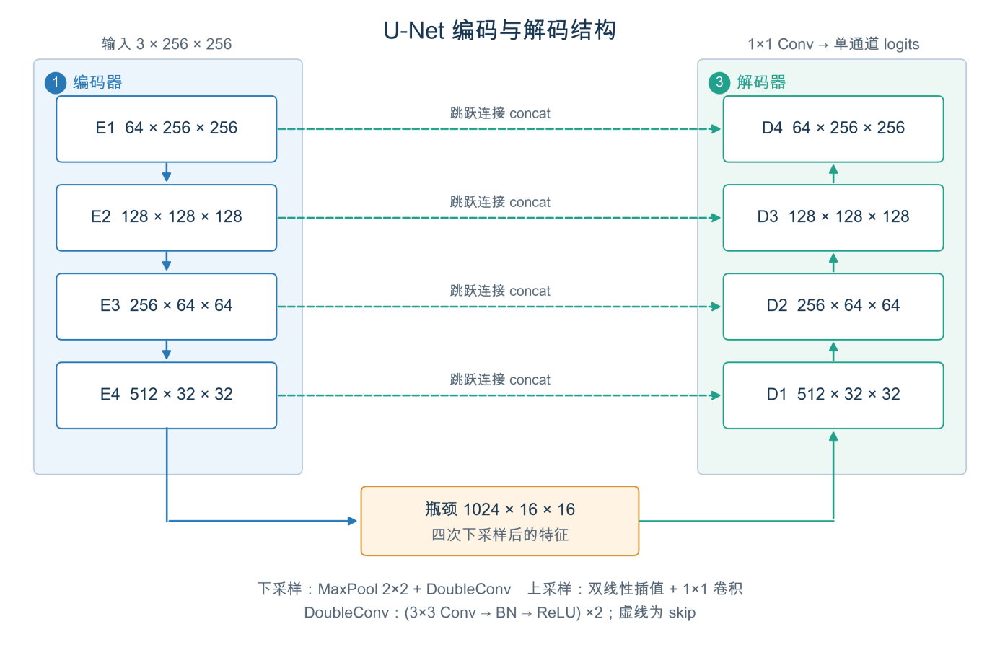{width="5.94488188976378in" height="3.8645002187226596in"}

图1　U-Net编码与解码结构

注：依据实际模型源码绘制；蓝色为编码路径，绿色为解码路径，橙色为瓶颈或门控。

## 3.2 ResUNet残差学习

结构图展示残差块与跨层拼接在本实现中的不同位置。参考残差U-Net的组合思路⁠[^\[2\]^](#ref-2)，残差块输出为ReLU(F(x)+S(x))。F包含两次卷积和BN；当通道数或空间步长变化时，S使用1×1卷积与BN对齐，否则为恒等映射。加法发生在块内部；编码器和解码器间仍然concat，不能将这两类连接混为一谈。

ResUNet的下采样采用stride=2的残差卷积，解码仍采用双线性插值、1×1卷积与残差块。因此本实验同时改变了块结构和下采样方式，不能把结果全部归因于某一条残差通路。残差形式使梯度存在较直接的传播路径，但是否改善本任务收敛，仍需依据训练过程判断。

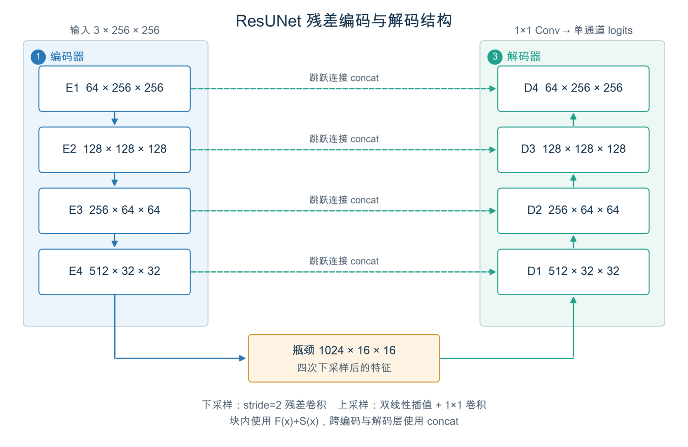{width="5.94488188976378in" height="3.8645002187226596in"}

图2　ResUNet残差编码与解码结构

## 3.3 Attention U-Net空间门控

结构图展示四个跳跃层上的门控位置。参考Attention U-Net的空间筛选机制⁠[^\[3\]^](#ref-3)，注意力门接收编码特征x与更深层解码特征g；先将g双线性插值到x的尺度，用两个1×1卷积统一通道后相加。简化表达为：

$\alpha = \sigma\left( BN(\psi(ReLU(W_{x}x + W_{g}g))) \right),\quad\quad\widehat{x} = \alpha \odot x$　（1）

α是单通道空间权重图，广播乘到所有skip通道，不是每个通道独立评分，也不是Transformer自注意力。默认all使用g1、g2、g3、g4；skip仅启用浅层g1/g2；bottleneck仅启用靠近瓶颈的g4跳跃连接，并没有在瓶颈主干加入Transformer。门控可抑制部分无关位置，但也可能压低有用边界信息，需通过实际结果检验。

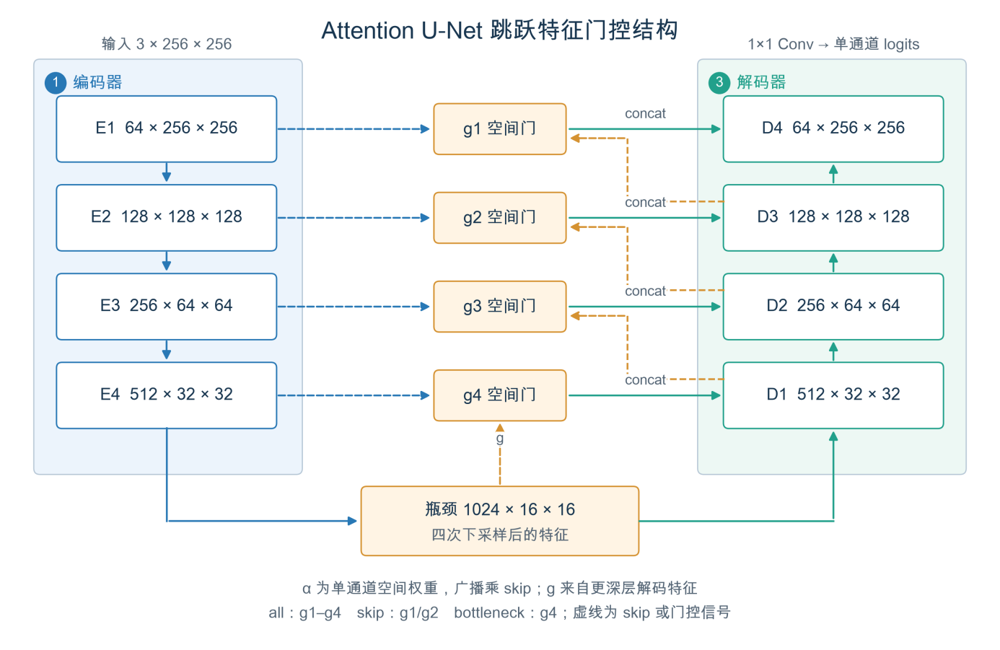{width="5.94488188976378in" height="3.8645002187226596in"}

图3　Attention U-Net空间门控结构

## 3.4 SAM与视觉Transformer

SAM采用ViT-B图像编码器、提示编码器和Two-Way掩膜解码器⁠[^\[4\]^](#ref-4)。本实现从384母版读取256网格，再缩放为1024输入；坐标同步乘4，输出与评价回到256网格。放大输入不会恢复母版丢失的细节，直接正方形缩放也与官方保持长宽比的预测流程不同。

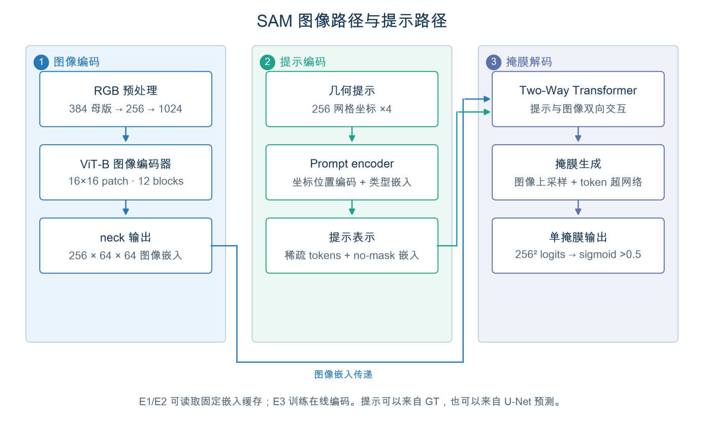{width="5.94488188976378in" height="3.6403379265091864in"}

图4　SAM图像与提示双路径

Transformer通过查询Q、键K和值V进行内容相关的信息聚合⁠[^\[6\]^](#ref-6)：

$Attention(Q,K,V) = softmax(QK^{\top}/\sqrt{d_{k}})V$　（2）

ViT将图像划分为patch序列⁠[^\[7\]^](#ref-7)。本项目ViT-B采用16×16 patch、12层、768维、12头，得到64×64网格；零起始层2、5、8、11使用全局注意力，其余使用窗口注意力，neck输出256×64×64嵌入。此处与深度2、8头的Two-Way解码器均实际使用Transformer，满足作业二要求。空间门控仅产生单通道权重，与Q/K/V注意力机制不同。

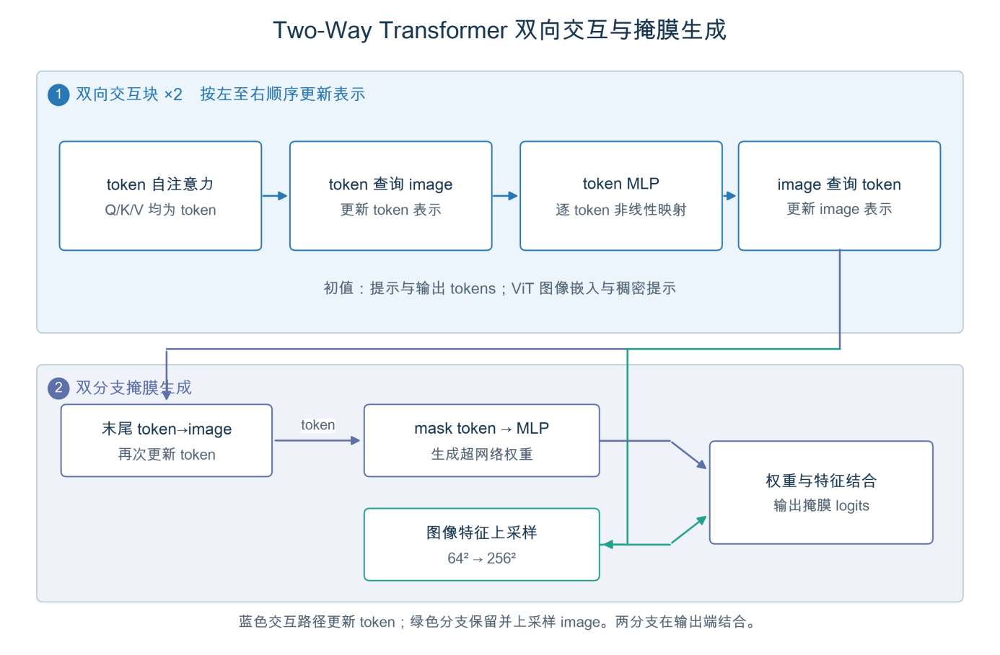{width="5.94488188976378in" height="3.8841633858267715in"}

图5　Two-Way Transformer双向交互与掩膜生成

提示编码器以位置和类型嵌入表示框角点或前景点；未使用mask提示时加入no-mask嵌入。解码后的mask token经MLP生成超网络权重，与上采样图像特征结合输出logits⁠[^\[8\]^](#ref-8)。本项目输出单掩膜，以sigmoid\>0.5二值化。模型内部IoU预测头属于质量估计，测试IoU由真实标签计算。

## 3.5 LoRA与自动提示级联

LoRA冻结原投影，以低秩增量调整模型⁠[^\[9\]^](#ref-9)：

$W_{eff}x = W_{0}x + (\alpha/r)BAx$　（3）

本实现r=8、α=16，12层qkv投影各自建立独立的A、B矩阵，并用输出mask仅保留q/v增量。LoRA新增294912参数；E3同时训练prompt与decoder，联合优化4359472参数。参数节省需按联合优化范围解释。E3从原版SAM独立初始化，未接续E2。

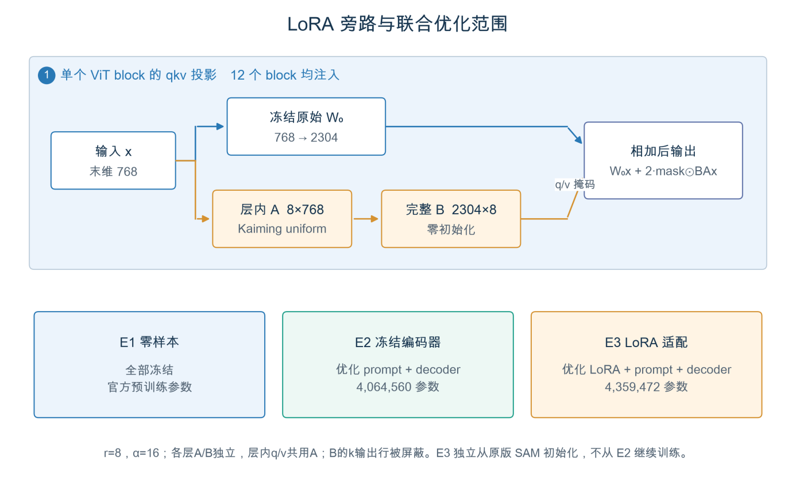{width="5.94488188976378in" height="3.1736614173228346in"}

图6　低秩旁路与三阶段优化范围

自动级联先用unet_s42预测掩膜并取外接框，再将框输入SAM。1000条自动框中6条为空，按全图框回退；auto10将四边各外扩原框宽高的10%并截断。GT只用于级联评价，不能用于生成自动提示。

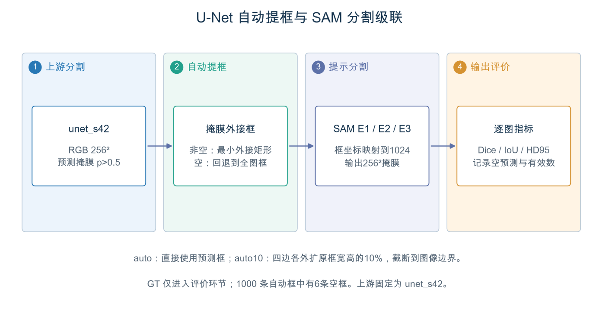{width="5.94488188976378in" height="3.1212259405074367in"}

图7　U-Net自动提框与SAM分割级联

# 四 实验设计

## 4.1数据与预处理

采用ISIC 2018 Task 1本地固定划分：train 2594、val 100、test 1000。384母版病灶前景均值分别为21.40%、26.84%、27.98%，提示训练与测试尺度分布存在差异。图像按ID与掩膜配对；未额外筛选手工特征，网络直接学习RGB表示。

卷积网络默认256输入，图像使用面积插值、掩膜使用最近邻并二值化；图像除以255后按ImageNet均值与标准差归一化，网络仍为随机初始化。训练包含翻转、±30°旋转、0.8---1.2缩放、平移、亮度对比度和噪声；验证测试只缩放与归一化。SAM沿用同一数据和256评价网格。修复后的E2保留固定原图嵌入，仅扰动框，取消可能破坏空间监督对应的嵌入翻转。

## 4.2指标与损失

逐图计算并对图像平均。TP、FP、FN、TN分别表示命中前景、误检、漏检和正确背景像素；区域指标为：

$Dice = \frac{2TP}{2TP + FP + FN},\quad\quad IoU = \frac{TP}{TP + FP + FN}$　（4）

$Sensitivity = \frac{TP}{TP + FN},\quad\quad Specificity = \frac{TN}{TN + FP}$　（5）

HD95取两方向最近边界距离各自95%分位的较大值，单位为评价网格像素。空预测仍进入Dice/IoU平均，但不进入HD95平均，因此需同时查看空预测与有效计数。灵敏度和特异度描述像素分割，不等同于临床诊断指标。

默认使用BCE与Soft Dice各占一半的混合损失，其中p为sigmoid概率，ε=10⁻⁶：

$L = 0.5L_{BCE} + 0.5\left( 1 - \frac{2\sum_{i}^{}p_{i}y_{i} + \epsilon}{\sum_{i}^{}p_{i} + \sum_{i}^{}y_{i} + \epsilon} \right)$　（6）

## 4.3实验配置与比较变量

表1　主要实验配置

  -----------------------------------------------------------------------------------------
       **项目**                  **卷积网络**                          **SAM**
  ------------------- ----------------------------------- ---------------------------------
      模型与阶段       U-Net / ResUNet / Attention U-Net   E1零样本 / E2局部微调 / E3 LoRA

       训练样本                      2594                         E2 2594；E3前600

    优化器与学习率           AdamW；1e-3；余弦调度                AdamW；E2/E3 1e-4

    默认输入与batch                 256；8                 1024编码、256评价；8 / 1×累积8

       设定预算              12轮上限；patience 6                  E2 20轮；E3 6轮

      重复与变量           三种子；损失、尺寸、门控            框扰动、点数、自动提示
  -----------------------------------------------------------------------------------------

卷积主实验种子为42、2026、7，均值误差条使用分母n−1的样本标准差。消融固定种子42，比较BCE/Dice/混合、192/256/384输入和浅层/深层/全部门控；五折作为补充验证，留出折参与权重选择，其独立性有限。SAM十类提示包括GT框、±10%/±20%扰动框、1/3/5点、auto和auto10；前八类由GT构造，属于模拟交互。没有开展LoRA秩或学习率搜索。

## 4.4实现修复与完整复验

E2取消缓存特征翻转，保持嵌入、框与GT同坐标；E3完整恢复LoRA、提示编码器、解码器及缩放参数；训练器在保存last前更新best和耐心计数，编排按目标轮数验收。数据与权重身份、命令和日志单独存证。

完整复验包括E2 20轮、E3 6轮，以及384输入重新训练与测试；E2/E3各10类提示均覆盖1000张测试图。三者best分别为第9、2、2轮，与日志峰值和last一致。其余24组卷积实验及E1核对后保留。E3同图多提示复用当前模型在线嵌入，重新编码的预测逐像素一致，未使用原版缓存。详细核验见附录B。

# 五 实验结果分析

## 5.1卷积模型总体比较

九份正式test JSON重算得到U-Net、ResUNet、Attention U-Net的Dice均值分别为0.5939、0.6077、0.6080。图8用误差条呈现重复波动；三次重复不足以支持稳定的结构优势。区域与边界排名不一致，且HD95剔除空预测，选择模型时需同时查看失败数量。

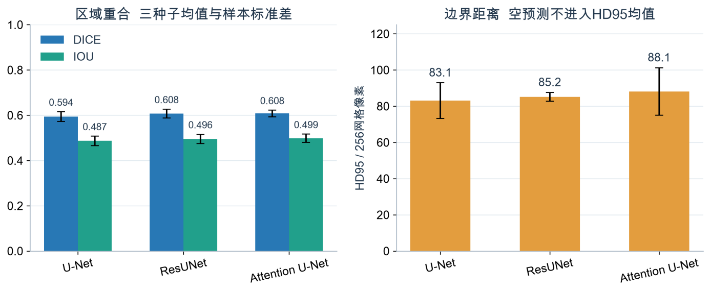{width="6.299212598425197in" height="2.5995100612423445in"}

图8　卷积模型区域与边界指标比较

图9保留全部九次验证轨迹，显示同一结构也会出现早期峰值和后续回落。图10进一步提供学习率与单轮成本，帮助区分结构差异、优化过程和资源投入；完整逐次分数移至附录A，正文不再重复铺表。

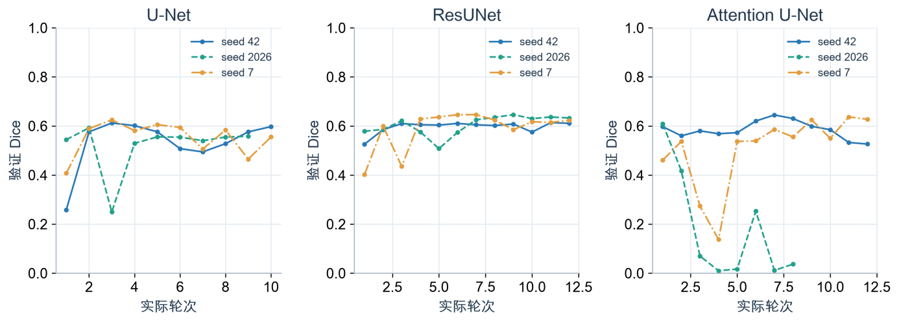{width="6.299212598425197in" height="2.2689096675415574in"}

图9　九次主实验的验证Dice轨迹

注：原始轮次直线连接，不进行平滑；颜色和线型共同区分种子。

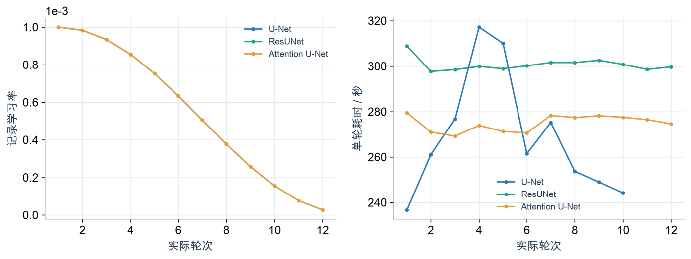{width="6.299212598425197in" height="2.3736450131233595in"}

图10　学习率与每轮训练成本

## 5.2超参数与补充验证

图11表明本次混合损失比BCE具有更好的前景重合，全部门控优于两个局部开关。384输入修复后Dice由0.4756变为0.5810，仍低于192输入的0.6391；两者训练成本、优化轨迹与HD95网格不同，不能据此断言低分辨率普遍更优。单种子消融用于提出后续假设，仍需匹配预算并重复验证。

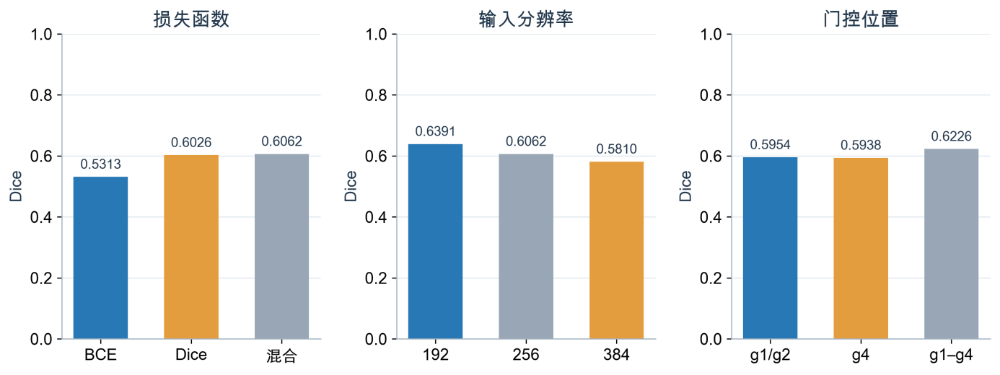{width="6.299212598425197in" height="2.363465660542432in"}

图11　损失函数输入尺度与门控位置的比较

五折补充验证中ResUNet为0.5698±0.0349，Attention U-Net为0.5631±0.0679，后者折间波动更大。留出折同时参与选权重，且模型选择参考过test结果，因此不能作为独立嵌套交叉验证证据。各折数据见附录A。

## 5.3 SAM提示工程与自动级联

图12将三阶段和十类提示置于同一矩阵。E2的GT框Dice为0.9181，高于E1的0.8691及E3的0.8970；提示内缩会遗漏边缘，改用点提示也改变了可用的定位信息。本轮E2的点数增加改善重合，是否普遍成立仍需多种子验证。E3只用600张训练图像，而E2使用2594张，因此阶段差异不能单独归因于LoRA机制。

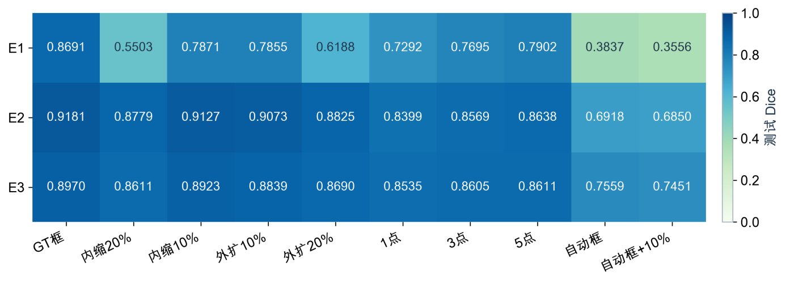{width="6.299212598425197in" height="2.268755468066492in"}

图12　三阶段十种提示的最终Dice矩阵

图13显示GT框到自动框的性能落差。固定上游unet_s42的Dice为0.6062，E2与E3自动框级联分别为0.6918和0.7559；E3相对上游提高约14.97个百分点，自动化能力应在这一路径下讨论。外扩10%后E2为0.6850、E3为0.7451，不能预设外扩必然改善结果。GT框及前景点由真实标签生成，只代表模拟交互条件。E1/E2读取原版缓存，E3在线编码，记录时延不作为统一部署速度比较。

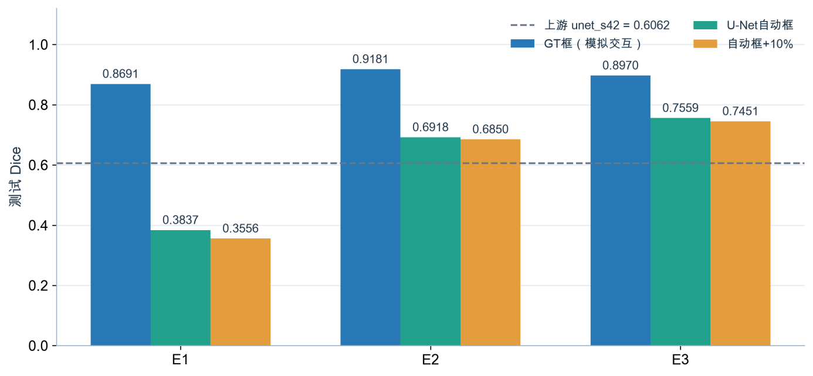{width="6.299212598425197in" height="2.916505905511811in"}

图13　GT框与自动框条件的最终比较

## 5.4相同测试样本的真实预测

按测试GT面积接近10%、50%、90%分位固定三个样本ID，两类模型使用相同图像；U-Net无提示，SAM使用GT框。图14保留原图、真实掩膜、预测和误差，直接满足课程对测试案例的要求。小病灶例出现背景误检，大病灶例存在漏检和碎片；分位选样不代表最好或最差结果，三例也不能替代全测试均值。

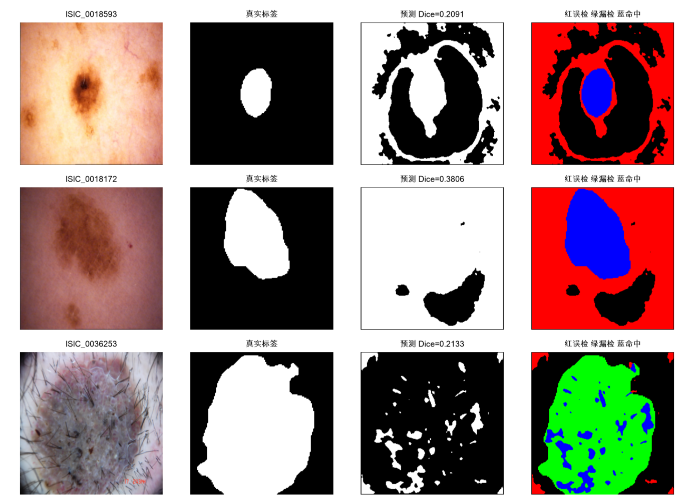{width="6.299212598425197in" height="4.581244531933509in"}

图14　固定测试样本的U-Net预测与误差

图15使用新选定权重重新生成同一组三个样本的GT框预测，直观对照不同适配方式的边缘覆盖。图中每个Dice直接由展示的二值掩膜计算，并与正式全测试JSON中相同ID的记录核对。该案例补充总体均值，不能代表全体样本的误差分布。

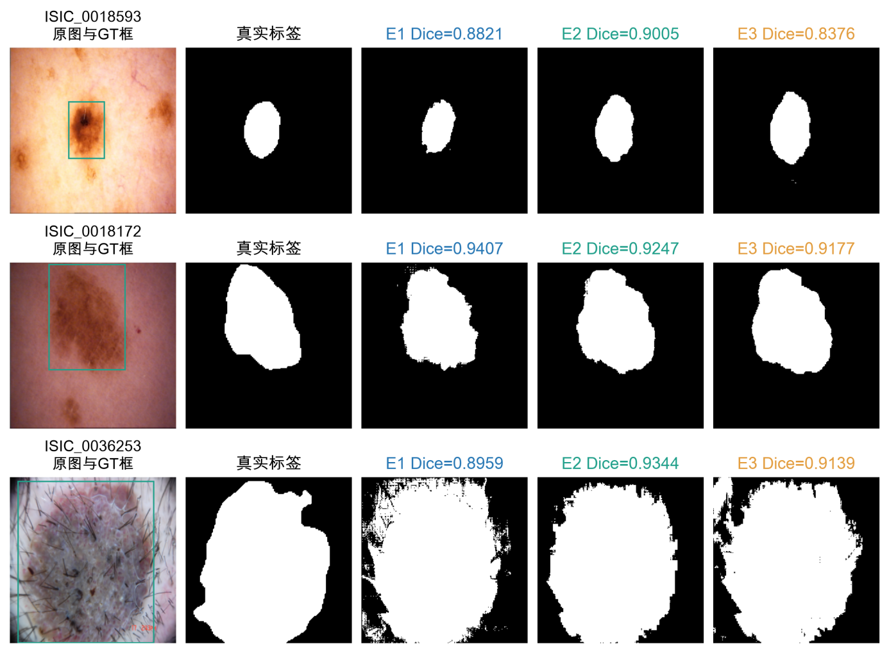{width="5.78740157480315in" height="4.257918853893264in"}

图15　同样本与GT框下的SAM最终预测

# 六 报告总结

本项目完成手写医学分割网络、Transformer提示分割及自动提框级联，覆盖课程要求的总体比较、超参数比较和实际测试案例。卷积模型的结构收益较小，提示条件对SAM影响明显；实验解释必须同时考虑随机波动、数据预算和实现一致性。

**[个人观点一：先确定模型能获得什么信息，再比较分数。]{.mark}**GT提示使用了测试标注，自动提示才对应无人交互链路；预训练先验和上游成本也应纳入评价。

**[个人观点二：复杂结构需要稳定证据支撑。]{.mark}**残差、门控和LoRA都有合理动机，但当前结果不足以说明其普遍优势。预算匹配、多种子重复与失败样本比一次最高分更有说服力。

**[个人观点三：实现正确性是结论的前提。]{.mark}**监督坐标、模块权重恢复及续跑状态必须一致。本次以独立重训和完整评测解决权重缺失，并核对选中轮次与日志峰值；结论随新证据更新。

# 参考文献

[]{#ref-1 .anchor}\[1\] RONNEBERGER O, FISCHER P, BROX T. U-Net: Convolutional Networks for Biomedical Image Segmentation\[C\]//Medical Image Computing and Computer-Assisted Intervention -- MICCAI 2015. Cham: Springer, 2015: 234-241. DOI: [10.1007/978-3-319-24574-4_28](https://doi.org/10.1007/978-3-319-24574-4_28).

[]{#ref-2 .anchor}\[2\] ZHANG Z, LIU Q, WANG Y. Road Extraction by Deep Residual U-Net\[EB/OL\]. (2017-11-29)\[2026-10-28\]. <https://arxiv.org/abs/1711.10684>.

[]{#ref-3 .anchor}\[3\] OKTAY O, SCHLEMPER J, LE FOLGOC L, et al. Attention U-Net: Learning Where to Look for the Pancreas\[EB/OL\]. (2018-05-20)\[2026-10-28\]. <https://arxiv.org/abs/1804.03999>.

[]{#ref-4 .anchor}\[4\] KIRILLOV A, MINTUN E, RAVI N, et al. Segment Anything\[EB/OL\]. (2023-04-05)\[2026-10-28\]. <https://arxiv.org/abs/2304.02643>.

[]{#ref-5 .anchor}\[5\] INTERNATIONAL SKIN IMAGING COLLABORATION. ISIC Challenge Datasets: 2018 Task 1\[DB/OL\].\[2026-10-28\]. <https://challenge.isic-archive.com/data/#2018>.

[]{#ref-6 .anchor}\[6\] VASWANI A, SHAZEER N, PARMAR N, et al. Attention Is All You Need\[C\]//Advances in Neural Information Processing Systems. Vol. 30. 2017. <https://papers.nips.cc/paper/7181-attention-is-all-you-need>.

[]{#ref-7 .anchor}\[7\] DOSOVITSKIY A, BEYER L, KOLESNIKOV A, et al. An Image is Worth 16x16 Words: Transformers for Image Recognition at Scale\[EB/OL\]. (2021-06-03)\[2026-10-28\]. <https://arxiv.org/abs/2010.11929>.

[]{#ref-8 .anchor}\[8\] META AI RESEARCH. Segment Anything: official implementation\[CP/OL\].\[2026-10-28\]. <https://github.com/facebookresearch/segment-anything>.

[]{#ref-9 .anchor}\[9\] HU E J, SHEN Y, WALLIS P, et al. LoRA: Low-Rank Adaptation of Large Language Models\[EB/OL\]. (2021-10-16)\[2026-10-28\]. <https://arxiv.org/abs/2106.09685>.

# 附录A完整实验数据

本附录保留支撑正文比较的完整数值。默认网格256；192/384消融在各自网格计分。除特别注明外，test n=1000；种子间、折间与逐图离散度不可互换。正式JSON/CSV位于repository各实验outputs/logs；E2/E3及384输入已替换为本次复验，其他结果保留。

表2　数据集划分与病灶前景分布

  -------------------------------------------------------------------------------------------------
      **划分**      **样本数**   **前景均值**   **中位数**   **5% / 95% 分位**   **空 / 多连通域**
  ---------------- ------------ -------------- ------------ ------------------- -------------------
       train           2594         21.40%        13.82%      1.55% / 65.18%          0 / 731

        val            100          26.84%        21.63%      4.81% / 71.26%           0 / 9

        test           1000         27.98%        20.98%      3.46% / 75.72%          0 / 142
  -------------------------------------------------------------------------------------------------

表3　三种模型的测试性能汇总

  ---------------------------------------------------------------------------------------------------------
      **模型**       **Dice均值±SD**   **IoU**   **HD95 px**   **Sensitivity**   **Specificity**    **M**
  ----------------- ----------------- --------- ------------- ----------------- ----------------- ---------
        U-Net            0.5939\       0.4868       83.10          0.7115            0.8011         28.95
                         ±0.0218                                                                  

       ResUNet           0.6077\       0.4955       85.16          0.6948            0.8244         30.35
                         ±0.0194                                                                  

   Attention U-Net       0.6080\       0.4986       88.10          0.6917            0.8261         29.47
                         ±0.0148                                                                  
  ---------------------------------------------------------------------------------------------------------

表4　主实验逐种子结果与有效样本计数

  -------------------------------------------------------------------------------------------------------
       **tag**       **Dice**   **IoU**   **HD95**   **空预测**   **HD有效**   **轮数**   **日志峰值轮**
  ----------------- ---------- --------- ---------- ------------ ------------ ---------- ----------------
      unet_s42        0.6062    0.4900     93.89         6           994          10            3

     unet_s2026       0.5687    0.4643     74.66         21          979          9             2

       unet_s7        0.6067    0.5061     80.74         28          972          10            3

     resunet_s42      0.5857    0.4721     82.95         7           993          12            11

    resunet_s2026     0.6150    0.5047     84.83         11          989          12            9

     resunet_s7       0.6225    0.5098     87.69         7           993          12            7

    attn_unet_s42     0.6226    0.5141     82.84         7           993          12            7

   attn_unet_s2026    0.5930    0.4788     103.05        2           998          8             1

    attn_unet_s7      0.6085    0.5029     78.41         15          985          12            11
  -------------------------------------------------------------------------------------------------------

表5　单种子消融结果与训练耗时

  --------------------------------------------------------------------------------------------
     **设置**      **Dice**   **IoU**   **HD95 px**   **空 / HD有效**   **轮数**   **总分钟**
  --------------- ---------- --------- ------------- ----------------- ---------- ------------
        BCE         0.5313    0.4217       66.96         33 / 967          9          35.1

       Dice         0.6026    0.4920       84.66          5 / 995          7          27.5

    混合 / 256      0.6062    0.4900       93.89          6 / 994          10         44.8

      192输入       0.6391    0.5254       59.22          4 / 996          12         30.5

      384输入       0.5810    0.4753      124.24         15 / 985          8          64.3

       g1/g2        0.5954    0.4769       95.07          1 / 999          8          35.0

        g4          0.5938    0.4892       70.48         24 / 976          12         48.2

      g1--g4        0.6226    0.5141       82.84          7 / 993          12         55.0
  --------------------------------------------------------------------------------------------

表6　两模型五折验证结果

  -----------------------------------------------------------------------------------
     **模型**      **折0**   **折1**   **折2**   **折3**   **折4**   **均值±折间SD**
  --------------- --------- --------- --------- --------- --------- -----------------
     attn_unet     0.6000    0.6206    0.5723    0.5761    0.4467        0.5631\
                                                                         ±0.0679

      resunet      0.6054    0.5615    0.5872    0.5140    0.5811        0.5698\
                                                                         ±0.0349
  -----------------------------------------------------------------------------------

表7　GT框下三阶段最终测试结果

  ------------------------------------------------------------------------------------------------------
     **阶段**      **Dice**   **IoU**   **HD95 px**   **Sensitivity**   **Specificity**   **优化参数M**
  --------------- ---------- --------- ------------- ----------------- ----------------- ---------------
        E1          0.8691    0.7788       24.31          0.8469            0.8769              0

        E2          0.9181    0.8529       14.55          0.9463            0.9443            4.06

        E3          0.8970    0.8204       17.78          0.9330            0.9603            4.36
  ------------------------------------------------------------------------------------------------------

表8　GT框评测的有效计数与执行路径时延

  ----------------------------------------------------------------------------------------
      **阶段**      **空预测**   **HD有效**   **Sens有效**   **Spec有效**   **原始ms/图**
  ---------------- ------------ ------------ -------------- -------------- ---------------
         E1             0           1000          1000           998            15.01

         E2             0           1000          1000           998            15.08

         E3             0           1000          1000           998           1909.35
  ----------------------------------------------------------------------------------------

表9　E2与E3训练过程统计

  --------------------------------------------------------------------------------------------------
    **训练tag**    **轮数**   **峰值轮**   **val峰值**   **总分钟**   **平均秒/轮**   **中位秒/轮**
  --------------- ---------- ------------ ------------- ------------ --------------- ---------------
      e2_box          20          9          0.9205        17.15          51.5            51.8

      e3_lora         6           2          0.9040        128.63        1286.3          1159.3
  --------------------------------------------------------------------------------------------------

表10　三阶段十类提示的最终Dice

  -----------------------------------------------------------------------
      **提示**         **E1 Dice**       **E2 Dice**       **E3 Dice**
  ----------------- ----------------- ----------------- -----------------
         gt              0.8691            0.9181            0.8970

       pert-10           0.7871            0.9127            0.8923

       pert-20           0.5503            0.8779            0.8611

       pert10            0.7855            0.9073            0.8839

       pert20            0.6188            0.8825            0.8690

       point1            0.7292            0.8399            0.8535

       point3            0.7695            0.8569            0.8605

       point5            0.7902            0.8638            0.8611

        auto             0.3837            0.6918            0.7559

       auto10            0.3556            0.6850            0.7451
  -----------------------------------------------------------------------

表11　自动框级联与上游模型的最终结果

  ---------------------------------------------------------------------------------------
     **模型**      **提示**   **Dice**   **IoU**   **HD95 px**   **空预测**   **HD有效**
  --------------- ---------- ---------- --------- ------------- ------------ ------------
     unet_s42       无提示     0.6062    0.4900       93.89          6           994

        E1           auto      0.3837    0.2983       93.41          0           1000

        E1          auto10     0.3556    0.2722       95.84          0           1000

        E2           auto      0.6918    0.5894       55.10          0           1000

        E2          auto10     0.6850    0.5815       56.37          0           1000

        E3           auto      0.7559    0.6549       49.86          0           1000

        E3          auto10     0.7451    0.6421       52.34          0           1000
  ---------------------------------------------------------------------------------------

表12　全部正式训练运行明细

  --------------------------------------------------------------------------------------------------------
       **tag**       **seed**   **size**   **loss**    **门控**    **实际轮**   **日志停止**   **峰值轮**
  ----------------- ---------- ---------- ---------- ------------ ------------ -------------- ------------
   attn_bottleneck      42        256      bce_dice   bottleneck       12          早停6           5

      attn_skip         42        256      bce_dice      skip          8           早停6           1

   attn_unet_s2026     2026       256      bce_dice      all           8           早停6           1

    attn_unet_s42       42        256      bce_dice      all           12           完成           7

    attn_unet_s7        7         256      bce_dice      all           12           完成           11

   cv_attn_unet_f0      42        256      bce_dice      all           12          早停6           5

   cv_attn_unet_f1      42        256      bce_dice      all           12           完成           12

   cv_attn_unet_f2      42        256      bce_dice      all           11          早停6           4

   cv_attn_unet_f3      42        256      bce_dice      all           12           完成           7

   cv_attn_unet_f4      42        256      bce_dice      all           9           早停6           2

    cv_resunet_f0       42        256      bce_dice      ---           12           完成           10

    cv_resunet_f1       42        256      bce_dice      ---           8           早停6           1

    cv_resunet_f2       42        256      bce_dice      ---           8           早停6           1

    cv_resunet_f3       42        256      bce_dice      ---           8           早停6           6

    cv_resunet_f4       42        256      bce_dice      ---           8           早停6           1

      loss_bce          42        256        bce         ---           9           早停6           2

      loss_dice         42        256        dice        ---           7           早停6           1

    resunet_s2026      2026       256      bce_dice      ---           12           完成           9

     resunet_s42        42        256      bce_dice      ---           12           完成           11

     resunet_s7         7         256      bce_dice      ---           12           完成           7

       size192          42        192      bce_dice      ---           12           完成           6

       size384          42        384      bce_dice      ---           8           早停6           2

     unet_s2026        2026       256      bce_dice      ---           9           早停6           2

      unet_s42          42        256      bce_dice      ---           10          早停6           3

       unet_s7          7         256      bce_dice      ---           10          早停6           3
  --------------------------------------------------------------------------------------------------------

表13　全部提示条件的IoU与失效计数

  -----------------------------------------------------------------------------------------------------
    **阶段**     **提示**   **IoU**   **HD95**   **空预测**   **HD有效**   **Sens有效**   **Spec有效**
  ------------- ---------- --------- ---------- ------------ ------------ -------------- --------------
       e1           gt      0.7788     24.31         0           1000          1000           998

       e1        pert-10    0.6625     27.75         0           1000          1000           998

       e1        pert-20    0.3887     42.03         0           1000          1000           998

       e1         pert10    0.6805     35.44         0           1000          1000           998

       e1         pert20    0.5039     51.48         0           1000          1000           998

       e1         point1    0.6241     40.82         0           1000          1000           998

       e1         point3    0.6632     42.21         0           1000          1000           998

       e1         point5    0.6862     39.36         0           1000          1000           998

       e1          auto     0.2983     93.41         0           1000          1000           998

       e1         auto10    0.2722     95.84         0           1000          1000           998

       e2           gt      0.8529     14.55         0           1000          1000           998

       e2        pert-10    0.8448     15.04         0           1000          1000           998

       e2        pert-20    0.7965     18.97         0           1000          1000           998

       e2         pert10    0.8360     16.79         0           1000          1000           998

       e2         pert20    0.7988     20.88         0           1000          1000           998

       e2         point1    0.7472     28.44         0           1000          1000           998

       e2         point3    0.7648     31.05         0           1000          1000           998

       e2         point5    0.7748     30.25         0           1000          1000           998

       e2          auto     0.5894     55.10         0           1000          1000           998

       e2         auto10    0.5815     56.37         0           1000          1000           998

       e3           gt      0.8204     17.78         0           1000          1000           998

       e3        pert-10    0.8151     17.71         0           1000          1000           998

       e3        pert-20    0.7736     21.70         0           1000          1000           998

       e3         pert10    0.8002     20.14         0           1000          1000           998

       e3         pert20    0.7788     23.52         0           1000          1000           998

       e3         point1    0.7674     24.87         0           1000          1000           998

       e3         point3    0.7724     26.13         0           1000          1000           998

       e3         point5    0.7732     25.95         0           1000          1000           998

       e3          auto     0.6549     49.86         0           1000          1000           998

       e3         auto10    0.6421     52.34         0           1000          1000           998
  -----------------------------------------------------------------------------------------------------

# 附录B修复验证与快速复现

## B.1修复验证

已完成E2 20轮、E3 6轮与384输入问题实验的独立训练，随后完成E2/E3各10类提示与384输入的1000张测试评测。训练best轮次、日志峰值和last元数据一致；其余卷积权重核对通过，未扩大重跑范围。回归检查及逐像素编码复用核验通过。完整命令、日志、逐样本结果和哈希见验证记录/完整复验及repository/RESULTS_RELEASE.json；历史文件单独归档。

## B.2获取代码并查看结果

仓库地址：https://github.com/12334rrr/graduate-machine-learning。本次修复与报告尚未推送远端，精确复用请进入压缩包repository；远端基线为4ac7b1ec。先运行以下命令检查文件、重算最终汇总并打开门户：

> cd repository
>     python3 quick_reproduce.py check
>     python3 quick_reproduce.py summary
>     python3 quick_reproduce.py portal

浏览器访问http://127.0.0.1:8800/#/hw1或#/hw2。结果展示仅依赖Python标准库，不需要数据、训练权重或问答密钥。

## B.3训练与推理复验

完整环境、下载、训练及十类提示命令见repository/QUICKSTART.md。保持hw1_unet、hw2_sam、dataset_hub同级，先准备ISIC数据和官方SAM ViT-B权重，再执行隔离小规模验证：

> python quick_reproduce.py smoke unet
>     python quick_reproduce.py smoke e1

本次正式命令见repository/QUICKSTART.md。需要重训时使用独立副本和新输出目录，完整训练采用连续运行避免分段续跑改变随机轨迹。提交包提供E2/E3及384输入的推理权重，原始数据、官方SAM基础权重和嵌入需按说明准备。

# 附录C实际前端与电子图录

前端把原始日志、源码和图片连接起来，用于复核实验。以下为本地实际页面截图；37张原始画廊图以原字节保留在随包电子图录，避免重复占用报告页面。截图重新采集于正式结果更新后的页面；配色、提示矩阵和三级联比较与正文一致。

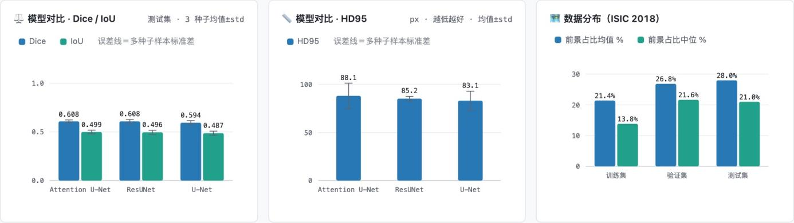{width="6.299212598425197in" height="1.7714391951006123in"}

图16　实际前端的卷积模型比较页面

注：真实页面截图；JSON为指标来源。

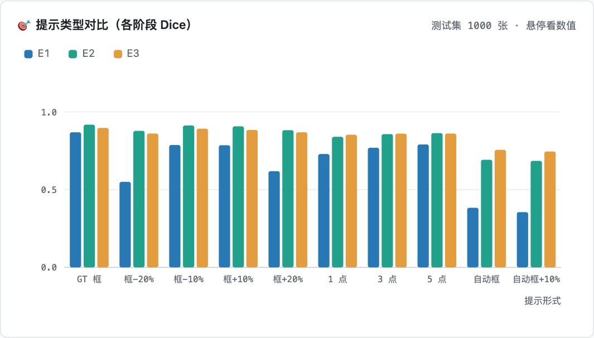{width="6.299212598425197in" height="3.584339457567804in"}

图17　实际前端的SAM提示类型页面

注：页面与提示构造代码对应；原始图片目录见电子图录。
