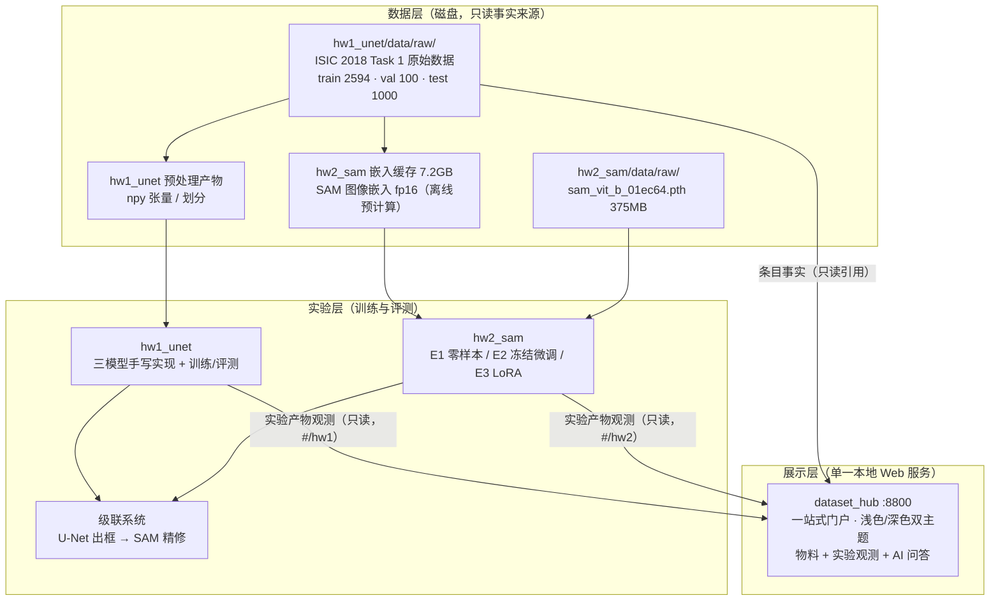

# MedSeg Hub · 医学图像分割课程作业

> **皮肤病变分割：手写 U-Net 系列 + SAM 提示分割 + 一站式科研门户**
> 数据层 → 实验层 → 展示层，一个端口看完整个作业。

本仓库包含两份课程作业与一个把它们缝在一起的门户：
**作业 1** 手写 U-Net / ResUNet / Attention U-Net 做 ISIC 2018 病灶分割；
**作业 2** 在 SAM ViT-B 上做 E1 零样本 / E2 冻结微调 / E3 LoRA 三阶段实验，并用作业 1 的预测框做**级联精修**；
**门户** 把数据集、术语、榜单、AI 问答与两作业的实验观测收进同一个浅色/深色双主题的 Web 应用。

本文件讲清：三层架构（数据 / 实验 / 展示）、三个子项目各自干什么、数据怎么流、密钥在哪配。
AI 协作约定见 [CLAUDE.md](CLAUDE.md)。

## 三个子项目

| 子项目 | 内容 | 端口 |
| --- | --- | --- |
| [hw1_unet/](hw1_unet/) | **作业 1**：手写实现 U-Net / ResUNet / Attention U-Net，在 ISIC 2018 Task 1 上做皮肤病变边界分割，指标 Dice / IoU / HD95 | 门户 `#/hw1` |
| [hw2_sam/](hw2_sam/) | **作业 2**：SAM ViT-B 三阶段实验——E1 零样本评测 / E2 冻结编码器微调解码器 / E3 LoRA(r=8) 微调 q/v 投影 | 门户 `#/hw2` |
| [dataset_hub/](dataset_hub/) | **一站式门户**：研究物料（数据集/术语/榜单/DeepSeek 问答）**+ 两个作业的完整实验观测**（训练曲线、评测档案、权重下载、源码浏览、图表画廊），支持**浅色 / 深色双主题**，详见其 [README](dataset_hub/README.md) | 平台 `8800` |

**一个端口（8800）看完整个作业**——数据集、术语、榜单、AI 问答与两作业实验观测全部融合在同一个门户里。
原先的两个暗色监控台（8801 / 8802）**已废弃**，全部功能已迁入门户，迁移对照见
[hw1_unet/dashboard/DEPRECATED.md](hw1_unet/dashboard/DEPRECATED.md) 与 [hw2_sam/dashboard/DEPRECATED.md](hw2_sam/dashboard/DEPRECATED.md)。

核心叙事贯穿始终——「级联系统」：作业 1 的 U-Net 小模型全自动出粗框 → 作为提示输入作业 2 的 SAM 精修，小模型提框、大模型精修，分工而非替代。

## 三层架构



ASCII 简版（终端查看）：

```
数据层   ISIC 2018 原始数据 ── 预处理 npy ── SAM 嵌入缓存 7.2GB ── SAM ViT-B 权重 375MB
           │                     │                    │                      │
实验层   ┌─────────────────────┴────────────────────┴──────────────────────┘
         hw1 三模型（U-Net/ResUNet/Attn U-Net）   hw2 E1 零样本 / E2 冻结 / E3 LoRA
              └────────────── 级联：U-Net 出框 → SAM 精修 ──────────────┘
           │ 只读事实/叙事 + 实验产物（实时扫描 outputs/）
展示层   dataset_hub :8800（一站式门户 · 浅色/深色双主题 · #/hw1 与 #/hw2 实验视图）
```

- **数据层 → 实验层**：训练脚本只读原始数据与权重；E2/E3 训练读嵌入缓存把每 epoch 从十几分钟降到几十秒。
- **实验层 → 展示层**：门户每次请求实时只读扫描两个作业的 `outputs/`（训练 CSV、评测 JSON、图表、checkpoints、嵌入缓存），实验一跑完门户立即呈现，不改动任何实验代码。

## 本地服务与端口

| 端口 | 服务 | 启动 |
| --- | --- | --- |
| `8800` | **一站式门户**（数据集 + 术语 + 榜单 + AI 问答 + 两个作业的实验观测，浅色/深色双主题） | `python3 dataset_hub/server.py`（标准库，无依赖） |
| ~~8801~~ | ~~hw1 监控仪表盘~~ | **已废弃**，功能并入 `#/hw1` |
| ~~8802~~ | ~~hw2 监控仪表盘~~ | **已废弃**，功能并入 `#/hw2` |

门户绑定 `127.0.0.1`，每次请求实时扫描两作业的 `outputs/`，训练进行中打开 `#/hw1` 点「自动刷新」即可看进度。

## 环境与密钥

- conda 环境：`hw1-unet-medseg`（作业 1）、`hw2-sam-transformer`（作业 2）；**dataset_hub 不需要任何环境**，系统 `python3` 即可。
- 网络：huggingface.co 不可达，镜像 `hf-mirror.com`、ModelScope 可用；`api.deepseek.com` 可用（门户 AI 助手用）。
- **密钥配置**：DeepSeek API key 只放在 `dataset_hub/.env`（已被 `.gitignore` 排除）或 shell 环境变量 `DEEPSEEK_API_KEY`，模板见 [dataset_hub/.env.example](dataset_hub/.env.example)，优先级与细节见 [dataset_hub/README.md](dataset_hub/README.md#配置ai-助手)。前端页面与 git 提交中不得出现明文密钥。
