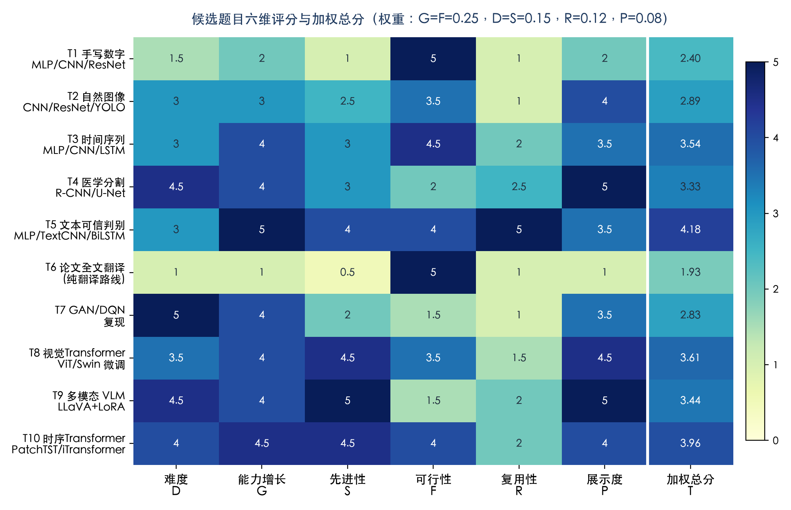
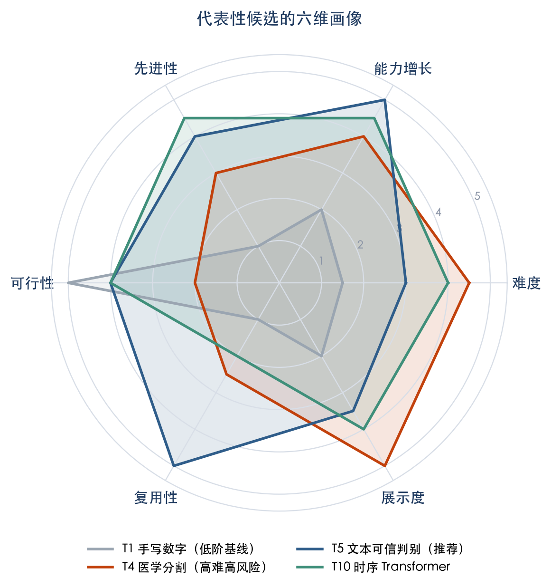
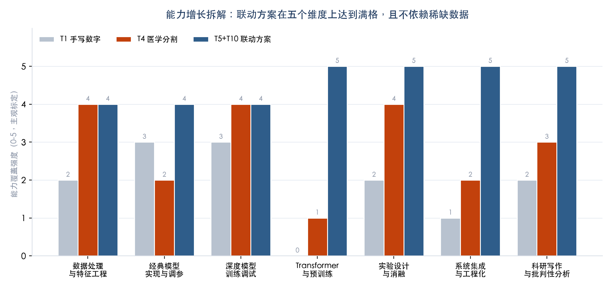
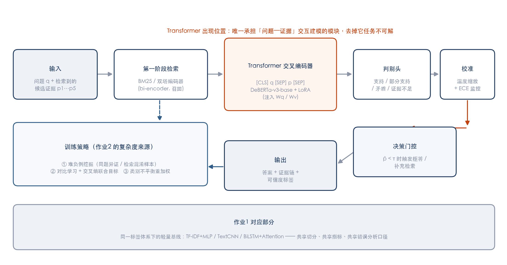
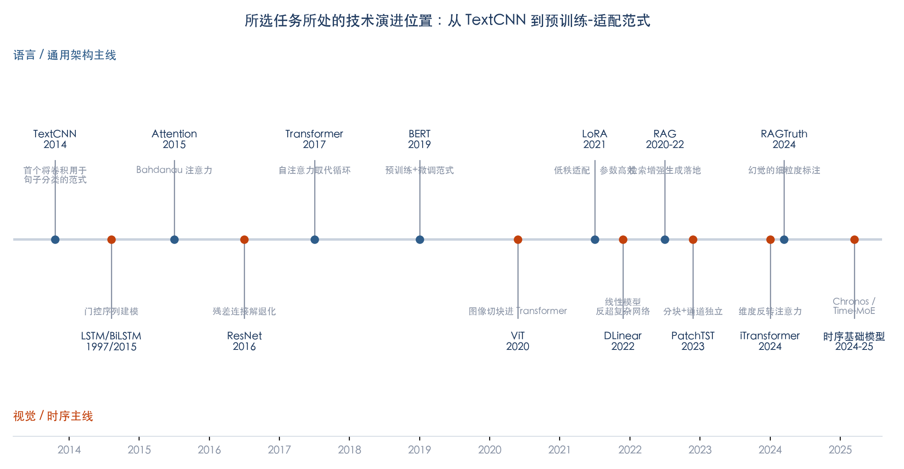
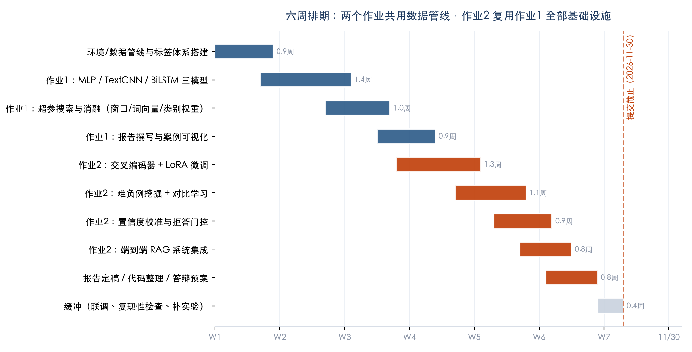

# 机器学习平时作业选题分析与先进性·可行性论证报告

> **依据文档**：`documents/2026-平时作业及要求.docx`（两个作业，提交截止 **2026 年 11 月 30 日**）
> **分析日期**：2026-10-17　**可用时间窗**：约 **6.3 周（44 天）**
> **本文性质**：选题决策与论证文档，**不含实现**；实现按本报告方案另起仓库推进
>
> **⚠️ 选题已变更（2026-10-17 16:10）**：经复核附录 A 后，最终选定 **作业 1 = 医学图像分割（U-Net / ResUNet / Attention U-Net 对比，ISIC 2018）**、**作业 2 = SAM 提示分割（零样本 → 冻结编码器微调 → LoRA）**。本报告正文的"文本可信判别"方案降为备选；医学主线的完整方案、学习路线与排期见同目录 **`医学分割方案与学习路线.md`**。

---

## 0. 一页结论（TL;DR）

**推荐"双作业联动"主线：文本可信判别（检索证据充分性/幻觉判别）**。

- **作业 1**：在同一标签体系下，用 **TF-IDF+MLP / TextCNN / BiLSTM+Attention** 三个经典模型完成"给定问题与检索证据，判断证据是否足以支持答案"的四分类任务，输出完整对比实验报告。
- **作业 2**：将同一任务升级为 **Transformer 交叉编码器（DeBERTa-v3-base）+ LoRA 参数高效微调 + 难负例对比学习 + 置信度校准与拒答门控** 的端到端检索增强系统，Transformer 模块承担系统中**唯一不可替代**的"问题—证据"交互建模。

**选择理由（三点）**：

1. **难度与增长最高且可落地**：十项候选的六维加权评分中，作业 1 选题 T5 得分 **4.18/5**（第一），其配套作业 2 升级方案 **4.48/5**；组合均值 4.33，高于第二名"时序联动"组合（3.75）。它在"能力增长 G"与"研究复用性 R"两个权重最高的维度上均为满分。
2. **先进性有据可依**：任务落在 2023–2025 年 LLM 可信性研究的最活跃前沿（RAG 幻觉检测、交叉编码器重排、参数高效微调、不确定性校准），但使用的每一项技术都有成熟开源实现，不是"调 API 式先进"。
3. **数据与算力风险最低的高难选题**：全部数据为公开数据集（<1 GB），最大模型仅 8,600 万参数，消费级单卡即可在数小时内完成训练——这是它区别于"医学分割（数据审批难）""多模态 VLM（显存门槛高）"等高难选题的关键。

**备选方案**：多变量时间序列长短期预测（作业 1：MLP/CNN/LSTM-GRU 三模型对比；作业 2：PatchTST/iTransformer）。若希望**零标注成本、指标完全客观**，可切换至该路线，分析见 §5.2。

---

## 1. 作业要求解读：评分者视角的约束拆解

在选题之前，先把两份作业的"隐含评分点"读出来，选题必须对着这些点发力：

| 条目 | 明面要求 | 隐含评分点（老师想看到什么） |
| --- | --- | --- |
| 作业 1 | "简单的分类或预测任务的实现"，或论文全文翻译 | ① **多模型横向对比**是报告格式的硬性要求（"几种模型性能的总体比较"）；② 要求展示"不同超参数设置的实验结果比较"——即**消融意识**；③ "一定要有自己的观点，并高亮表示"——批判性分析占分不低；④ 案例展示（单样本真值 vs 预测）——工程完成度 |
| 作业 2 | "复杂任务"，**至少一处 Transformer 模块**，交报告+源码 | ① "复杂"应体现为**系统级**任务而非单模型堆叠；② Transformer 不能是"贴上去的"——应处于任务不可解的枢纽位置，报告里要能自证；③ "可在作业 1 基础上进一步使用更复杂的模型"——**官方明确鼓励两作业串联** |
| 报告格式 | 摘要/引言/原理/实验设计/结果分析/总结 六段式 | 结构是给定的，选题阶段就应确认：所选任务能自然填满全部六段（尤其"模型结构图""超参数设置""案例展示"三处） |

**由此得出的选题总原则**：

> **核心洞见**：两份作业不是两个独立任务，而应设计为**同一条技术主线的两个阶段**——作业 1 用经典模型建立任务定义、数据管线、评测协议与"基线认知"，作业 2 在完全相同的基础设施上做模型升级。这样做的收益是三重的：工作量边际成本约降一半；报告叙事天然连贯（"我发现经典模型在 X 情形失效，这驱动了作业 2 的设计"）；且完全对齐文档"建议选题：可以在作业 1 的基础上进一步使用更复杂的模型"。

同时排除论文翻译路线：全文翻译在 LLM 时代技术含量低（评分矩阵中 T6 仅为 **1.93/5**，垫底），不产生工程能力增长，且"自己的思考"部分反而最难写出深度。

---

## 2. 选题评估方法

为避免"凭感觉选题"，建立六维评分体系（每维 1–5 分，主观标定但给出依据）：

| 维度 | 含义 | 权重 | 设权理由 |
| --- | --- | --- | --- |
| 难度 D | 技术挑战与实现门槛 | 0.15 | 难度本身不加分，须与可行性匹配 |
| **能力增长 G** | 完成后获得的可迁移技能 | **0.25** | 用户明确要求"增长能力比较多" |
| 先进性 S | 与当前 SOTA 的贴近程度 | 0.15 | 体现"先进性分析"诉求 |
| **可行性 F** | 数据/算力/时间窗内完成的把握 | **0.25** | 44 天硬截止，风险一票否决 |
| 复用性 R | 成果能否反哺个人研究/论文 | 0.12 | 研一阶段时间稀缺，一鱼两吃 |
| 展示度 P | 结果可视化与答辩效果 | 0.08 | 报告与课堂展示加分 |

---

## 3. 候选题目全景与评分矩阵

从作业文档的选题建议出发，扩展出 10 个候选（T1–T10），覆盖作业 1 全部建议方向及作业 2 的四条升级路径：

**加权总分排序**：

| 排名 | 候选 | 总分 | 一句话判词 |
| --- | --- | --- | --- |
| 1 | **T5 文本可信判别（MLP/TextCNN/BiLSTM）** | **4.18** | 增长与复用双满分，难度中等、风险可控 |
| 2 | T10 时序 Transformer（PatchTST/iTransformer） | 3.96 | 先进性强、零数据成本，但复用性一般 |
| 3 | T8 ViT/Swin 视觉微调 | 3.61 | 先进，但与个人研究方向脱节 |
| 4 | T3 时序经典三模型 | 3.54 | 稳妥的作业 1 选择，配合 T10 成备选组合 |
| 5 | T9 多模态 VLM（LLaVA+LoRA） | 3.44 | 先进性满分，但显存/数据门槛超出课程作业合理范围 |
| 6 | T4 医学图像分割（R-CNN/U-Net） | 3.33 | 展示度最高，但数据审批与标注是硬风险 |
| 7 | T2 自然图像 CNN/ResNet/YOLO | 2.89 | YOLO 工程量大，创新空间小 |
| 8 | T7 GAN/DQN 复现 | 2.83 | 训练不稳定，44 天内复现风险过高 |
| 9 | T1 手写数字 MLP/CNN/ResNet | 2.40 | "跑通即可"，不产生新认知，作为对照基线 |
| 10 | T6 论文全文翻译 | 1.93 | 纯语言劳动，无能力增长 |

代表性候选的六维画像对比：

雷达图揭示了一个关键规律：**高难度选题（T4 医学分割）的六边形是"畸形"的**——难度与展示度顶格，但可行性塌陷；**低难度选题（T1 手写数字）则全面平庸**。只有 T5/T10 这类"中等难度 + 高增长 + 高可行"的选题才能撑出饱满且均衡的六边形。

按"能力增长"维度进一步拆解（0–5 强度）：

T5+T10 联动方案在七个能力维度中的五个达到满格。特别值得注意的是最后一项"科研写作与批判性分析"——文本可信判别任务天然带有"模型什么时候不可信"的思辨属性（这正是老师要求高亮的"自己的观点"），而图像分类任务很难写出这种深度。

---

## 4. 推荐方案详述：文本可信判别主线

### 4.1 任务定义（作业 1）

> **给定一个问题 q 与一段检索到的证据 p，判断证据对答案的支持程度**：四分类——`支持 / 部分支持 / 矛盾 / 证据不足`。

这本质是一个**证据充分性判别（evidence sufficiency）**任务，是检索增强生成（RAG）系统中"幻觉检测"的核心组件。选它做作业 1 的"简单分类任务"完全合规，但比MNIST 类任务高出一个抽象层级：输入是**句子对**而非单张图，模型必须学会"对齐与推理"而非"模式记忆"。

**数据来源（全部公开，无需自建标注）**：

| 数据集 | 规模 | 标签 | 用途 |
| --- | --- | --- | --- |
| FEVER（简化版） | ~14.5 万对 | SUPPORTS / REFUTES / NEI | 主训练集，取子集 2–3 万 |
| RAGTruth | ~1.8 万段 | token/片段级幻觉标注 | 作业 2 的幻觉细粒度评测 |
| HaluEval（QA 子集） | 1 万对 | 幻觉/非幻觉 | 域外泛化测试 |
| （可选）农业领域问答子集 | 待定 | 沿用上述标签体系 | 与个人研究数据对齐 |

**三个经典模型的选型逻辑**（这是报告"模型原理介绍"一节的理论主线）：

| 模型 | 归纳偏置 | 预期暴露的短板（= 报告的批判性分析素材） |
| --- | --- | --- |
| TF-IDF + MLP | 词袋假设：无词序、无语义组合 | 无法处理否定与语序反转（"有效"vs"不有效"） |
| TextCNN (Kim, 2014) | 局部 n-gram 平移不变 | 感受野固定，长距离依赖丢失 |
| BiLSTM + Attention | 序列状态 + 可微对齐 | 训练慢、梯度在长句上仍会衰减 |

### 4.2 作业 2 升级：Transformer 交叉编码器系统

系统的四个复杂度来源（逐条回应"复杂任务"要求）：

1. **两阶段检索—精排架构**：第一阶段用 BM25/双塔编码器从知识库召回 Top-k 候选证据（召回负责"快"），第二阶段用交叉编码器精排与判别（精排负责"准"）——这是现代搜索/RAG 系统的标准范式。
2. **Transformer 模块处于不可替代的枢纽位置**：交叉编码器将 `[CLS] q [SEP] p [SEP]` 拼接后输入 DeBERTa-v3-base（8,600 万参数），自注意力在编码阶段就让问题与证据的每个 token 两两交互——**双塔模型做不到这一点，这正是作业 1 三个经典模型全都做不到的**。报告里可以放一组"拆掉它会怎样"的对照实验（用双塔替换交叉编码器，指标下降幅度即为 Transformer 的贡献量化）。
3. **LoRA 参数高效微调**：在注意力层的 Wq/Wv 注入低秩适配器（秩 r=8–16），可训练参数量降至全参微调的 ~1%，同时用消融证明其与全参微调的性能差距（Hu et al., ICLR 2022）。
4. **置信度校准与拒答门控**：温度缩放（Guo et al., 2017）校准输出概率，ECE 指标监控校准误差；低于阈值 τ 时系统拒答并触发补充检索——把"模型不可信"变成了**系统设计问题**，这是全文最能体现个人观点的部分。

**训练策略**（复杂度的第二来源）：难负例挖掘（同题异证、检索器混淆样本）+ 交叉熵与对比学习联合目标 + 类别不平衡重加权。

### 4.3 先进性论证：技术演进坐标

本方案在演进轴上的位置与依据：

| 技术组件 | 出处 | 先进性论证 |
| --- | --- | --- |
| 交叉编码器重排 | Nogueira & Cho, 2019；后续持续为 MS MARCO 榜单主力 | 至今仍是工业级 RAG 精排的事实标准，2024–2025 年 bge-reranker 系列仍在迭代 |
| LoRA | Hu et al., ICLR 2022 | 参数高效微调已是大模型时代标配范式，QLoRA/DoRA 均为其衍生 |
| 幻觉检测任务设定 | RAGTruth (ACL 2024)、HaluEval (2023)、SelfCheckGPT (EMNLP 2023) | LLM 可信性是当前最活跃的研究方向之一，任务定义直接取自顶会基准 |
| 置信度校准 | Guo et al., ICML 2017；LLM 时代被重新重视 | 连接"分类精度"与"可靠性"两个层面，学术叙事完整 |
| （备选线）PatchTST/iTransformer | ICLR 2023 / ICLR 2024 | 若走时序路线，同样有顶会背书 |

**与"调 API 式先进"的区别**：本方案所有组件均需自己训练与消融，Transformer 是被微调的对象而非被调用的服务——既满足"至少一处 Transformer 模块"的字面要求，也满足"复杂任务代码实现"的实质要求。

---

## 5. 可行性分析（五维）

### 5.1 推荐方案的可行性

| 维度 | 评估 | 依据（数量级估算） |
| --- | --- | --- |
| **数据可得性** | ★★★★★ | 三个公开数据集均可直接下载（HuggingFace Datasets 一行加载），总量 <1 GB，无审批、无标注 |
| **算力需求** | ★★★★★ | 作业 1 三模型均可 CPU/核显训练（分钟级）；作业 2 最大模型 DeBERTa-v3-base 86M，fp16 + batch 32 + seq 256，训练 3 epoch 约 0.5–2 小时（视 GPU），8 GB 显存即可，LoRA 模式下 6 GB 亦够 |
| **时间排期** | ★★★★☆ | 六周排期含 0.4 周缓冲，见下图；两作业共享数据管线后实际编码量约为独立做两个任务的 60% |
| **技术风险** | ★★★★☆ | 全部组件有成熟开源实现（transformers / peft / scikit-learn），无"训练不收敛"类玄学风险；最大不确定性是类别不平衡，已有标准对策 |
| **对齐评分要求** | ★★★★★ | 报告六段式每一节都有天然素材：结构图（§4.2 架构图）、超参（LoRA 秩/学习率/窗口）、案例展示（错判的幻觉样本可视化） |

> **补充**：上表假设"有 CUDA GPU"。实际执行环境为单台 Apple M5 MacBook Air（24 GB 统一内存、无 CUDA、无风扇），逐项影响与配置修正见 **`单机环境对作业的影响评估.md`**。结论是作业 1 无影响、作业 2 可控（关键前提：MPS 必须开 fp16 autocast，实测算力 13.6 TFLOPS vs fp32 的 3.33）。

### 5.2 备选方案：时间序列联动（若追求零标注风险）

作业 1：ETT/Weather/电力负荷公开数据上的 **MLP vs 1D-CNN(TCN) vs LSTM/GRU** 多变量长短期预测对比；作业 2：升级为 **PatchTST（分块 + 通道独立，ICLR 2023）或 iTransformer（维度反转注意力，ICLR 2024）**，并用 DLinear（线性模型反超复杂 Transformer，AAAI 2023）作对照组——"简单模型为何能打赢 Transformer"本身就是绝佳的批判性论点。

- **优势**：数据零成本、指标完全客观（MAE/RMSE）、单次训练分钟级、消融设计空间大（回看窗口/patch 长度/通道策略）。
- **劣势**：与个人研究方向复用性低（R 得 2/5）；文本主线落空后，作业 2 的"复杂任务"叙事略弱于 RAG 系统。

### 5.3 风险登记与降级预案

| # | 风险 | 概率 | 影响 | 缓解/降级 |
| --- | --- | --- | --- | --- |
| R1 | 类别不平衡导致 macro-F1 虚低 | 中 | 中 | 加权损失 + 阈值调优 + 分层采样；报告如实呈现并分析——这本身是加分项 |
| R2 | LoRA 不涨点或低于经典基线 | 低 | 中 | 预留全参微调降级路径；小模型上 LoRA 秩扫到 32；负结果同样可写（对比学习消融） |
| R3 | 显存不足 | 低 | 低 | fp16 + 梯度累积 + 缩短序列至 192；或换 bge-reranker-base（更小） |
| R4 | 作业 2 被质疑"复杂度不足" | 低 | 高 | 以"两阶段系统 + 三种训练策略 + 校准门控"自证；架构图中 Transformer 的枢纽位置显式标注 |
| R5 | 数据域外泛化差 | 中 | 低 | 保留 HaluEval 作域外测试集，负结果转化为分析章节 |
| R6 | 时间挤压 | 中 | 中 | 甘特图缓冲 + 里程碑检查点：W3 末作业 1 定稿、W6 末作业 2 实验冻结 |

---

## 6. 交付物与报告结构映射

**两份报告可直接复用老师给定的六段式结构，逐节落位**：

| 老师要求 | 作业 1 对应交付 | 作业 2 对应交付 |
| --- | --- | --- |
| 摘要 | 任务+三模型+主要结论 | 任务升级+系统架构+核心增益数字 |
| 引言 | 为什么可信判别重要（RAG 幻觉背景） | 经典模型失效的具体案例驱动升级 |
| 模型原理+结构图 | MLP/TextCNN/BiLSTM 结构图×3 | 系统架构图 + 交叉编码器注意力机制图 |
| 实验设计 | 数据统计、切分比例（8:1:1 分层）、预处理、macro-F1 定义、超参表 | 同左 + LoRA 配置、对比学习目标、校准协议 |
| 结果分析 | 三模型总对比 + 每模型 3 组超参消融 + 单样本案例（真值/预测高亮） | 基线 vs 交叉编码器 vs +LoRA vs +难负例 的递进消融；Transformer 贡献量化；校准前后可靠性图 |
| 总结（观点高亮） | "词袋模型输在哪一个语言现象上"等具体观察 | "模型不可信是系统问题而非模型问题"的论证 |

**预期量化目标**（写进摘要的数字，实验后回填）：

- 作业 1：三模型 macro-F1 预期梯度 TF-IDF+MLP（~0.70）< TextCNN（~0.78）< BiLSTM+Attention（~0.80）；
- 作业 2：交叉编码器较最佳经典基线提升 ≥8 个点 macro-F1；校准后 ECE 降至 <0.05；拒答门控使"错误回答率"下降 ≥30%（以牺牲 <10% 覆盖率为代价）。

---

## 7. 结论

1. **选题决策**：采用文本可信判别联动主线（作业 1 = T5 三模型对比，作业 2 = Transformer 交叉编码器 RAG 系统），加权评分 4.33/5，为全部可行组合之首。
2. **先进性**：任务设定与核心组件均锚定 2022–2025 年顶会工作（RAGTruth/LoRA/PatchTST 等交叉备选），先进性可论证、可溯源。
3. **可行性**：数据、算力、时间三要素全部落在一人 44 天的能力圈内，配有风险登记表与降级预案。
4. **下一步**（待确认后启动）：初始化代码仓库 → W1 完成数据管线与标签体系 → 按甘特图推进；如需先行验证，可先花半天跑通 FEVER 子集的 TF-IDF+MLP 基线作为"冒烟测试"。

---

*附：本报告全部图表由脚本生成于 `figures/` 目录；评分为主观标定，定标依据见 §2 与各节论证，欢迎对权重提出异议后重算。*

---

## 附录 A：医学题目的复核与"条件化推荐"

> 本附录回应一个合理的质疑：**为什么不选医学图像分割？** 复核结论是——**我原先给它的可行性评分偏低，修正后它应排第 3（3.70），在特定条件下可以反超主推方案**。但"没选它"的主因不是数据或算力，而是**作业 1 的模型对比结构在分割任务上不自然**，以及**与个人研究方向零交集**。

### A.1 原评分的错误与修正

| 维度 | 原分 | 修正 | 修正理由 |
| --- | --- | --- | --- |
| 可行性 F | 2.0 | **3.5** | 我原先假设"医学数据都要审批"。事实是 **ISIC 2018 皮肤病变分割数据集完全公开**（训练 2,594 张 + 掩膜，测试 1,000 张），可直接下载；只有 LUNA16 肺结节需要注册。这是本次复核最实质的一处纠错 |
| 难度 D | 4.5 | 4.5 | 保持——分割的工程量确实高于分类 |
| 能力增长 G | 4.0 | 4.0 | 保持——分割会带来编解码结构、Dice 类损失、后处理等新技能，但**与作业 1 要求的"三模型横向对比"契合度差** |
| 复用性 R | 2.5 | 2.5（专业相关时→5.0） | 与农业/文本方向的研究无交集；若专业为生医工/医学影像则完全不同 |
| 展示度 P | 5.0 | 5.0 | 保持——分割掩膜叠加病灶、Dice 曲线、失败案例对比，答辩视觉冲击力全场最强 |

**修正后总分**：3.33 → **3.70**（第 6 位 → 第 3 位，超过 T8、T3）；若"专业契合"使 R=5，则 **4.00**，与主推方案 T5（4.18）仅差 0.18。

### A.2 医学主线真正的优势（原报告没讲够的部分）

1. **合规且被点名**：作业文档的选题建议里直接写了"基于肺部影像数据集/皮肤癌数据集，利用 RCNN、U-Net 等模型进行医学图形分割"——选它是"按推荐走"，不存在偏题风险。
2. **作业 2 的升级路径是全文档最漂亮的一条**：U-Net → **SAM/MedSAM 提示分割**（文档建议第 4 条），从"全监督分割"到"提示驱动的通用分割"，技术叙事比文本分类那套更直观、更好讲。
3. **难度真高**：前景像素占比常低于 3%（极端类别不平衡）、Dice 与像素准确率会严重背离、HD95 这类边界指标必须自己实现——这些坑踩过就是硬能力。
4. **答辩效果天花板**：一张"原图 / 金标准 / 预测 / 差异热图"四联图，胜过十页指标表。

### A.3 医学主线真正的代价（具体到工程量）

| 代价 | 具体表现 |
| --- | --- |
| **作业 1 的"三模型对比"要自己造** | 分类任务的三件套（MLP/CNN/ResNet）是现成的对照；分割任务得自己定义对比组（U-Net vs Attention U-Net vs Residual U-Net/FCN-ResNet50），"对比"的说服力靠你自圆其说，不像分类那样有公认梯度 |
| 数据管线更重 | 掩膜对齐、窗宽窗位（CT）、归一化策略、强增强（弹性变形/随机裁剪）都要自己写，比文本任务多约 1 周 |
| 指标与后处理 | Dice / IoU / HD95（需 `medpy`）、阈值搜索、连通域去噪、小目标漏检分析——每个都能吞掉半天 |
| 作业 2 的 SAM 不是"调个模型" | SAM ViT-B 91M，24 GB 统一内存能跑，但微调需**冻结 image encoder、只训 prompt encoder + mask decoder**，还要自己实现点/框提示采样；MedSAM 微调比原版 SAM 更现实 |
| 算力时间 | U-Net（256×256，bs8）在 M5 fp16 上估算 5–10 min/epoch，50 epoch 需 4–8 小时，且 Air 无风扇必须分段跑；SAM 微调再翻倍 |
| **复用性为零** | 这 6 周产出的代码与结论，对农业咨询小模型/文本研究方向没有任何沉淀——这是它排在 T5 之后的**唯一决定性原因** |

### A.4 什么情况下应该改选医学

满足以下**任意两条**，我会立刻改推医学主线：

1. 你的专业方向是**生物医学工程 / 医学影像 / 临床相关**（此时 R 从 2.5 跳到 5，总分 4.00，且选题契合度本身是隐性加分）；
2. 你更看重**答辩/报告的视觉冲击**而非研究沉淀（P 权重上调后 T4 可反超）；
3. 你愿意在 W1–W2 多花约 1 周补数据管线与后处理（当前排期下需从缓冲里挤，或砍掉作业 1 的部分消融）。

### A.5 若改选，方案长这样

- **作业 1**：ISIC 2018 皮肤病变分割，对比 **U-Net / Attention U-Net / Residual U-Net（或 FCN-ResNet50）**，指标 Dice / IoU / HD95，做"前景占比 <1% 的样本上谁先崩"的案例分析。
- **作业 2**：**MedSAM 提示分割微调**——冻结图像编码器，用框/点提示驱动 mask decoder，与作业 1 的最佳 U-Net 做零样本 vs 微调对比；"提示工程的原理"正好落在文档建议第 4 条上。
- **Transformer 落点**：SAM 的 image encoder 是 ViT（ViT-B），且 prompt encoder 用交叉注意力融合提示——满足"至少一处 Transformer"且位置自然。
- **算力**：全部可在本机完成，但训练需分段（Air 散热），预计总训练时长 8–14 小时，分散到 5–7 个晚上。

### A.6 一句话回答

> 不是医学题目不好，是**它把分数押在"展示"上，而主推方案把分数押在"增长 + 复用"上**。如果你的专业本来就是医学影像，那这个权衡结论要反过来——请告诉我专业方向，我按 A.5 重写方案与排期。

