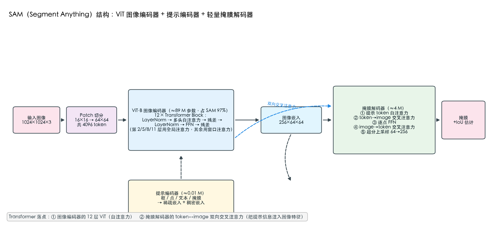
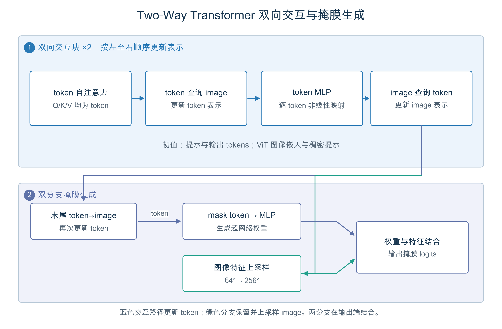
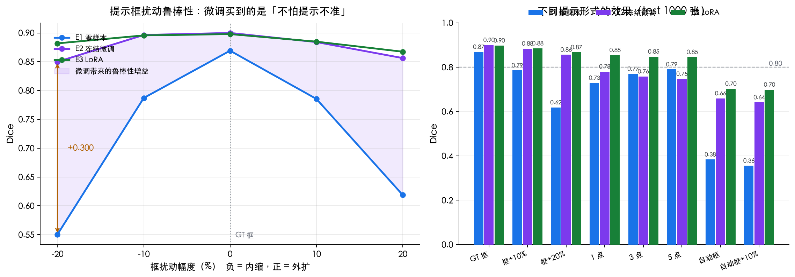
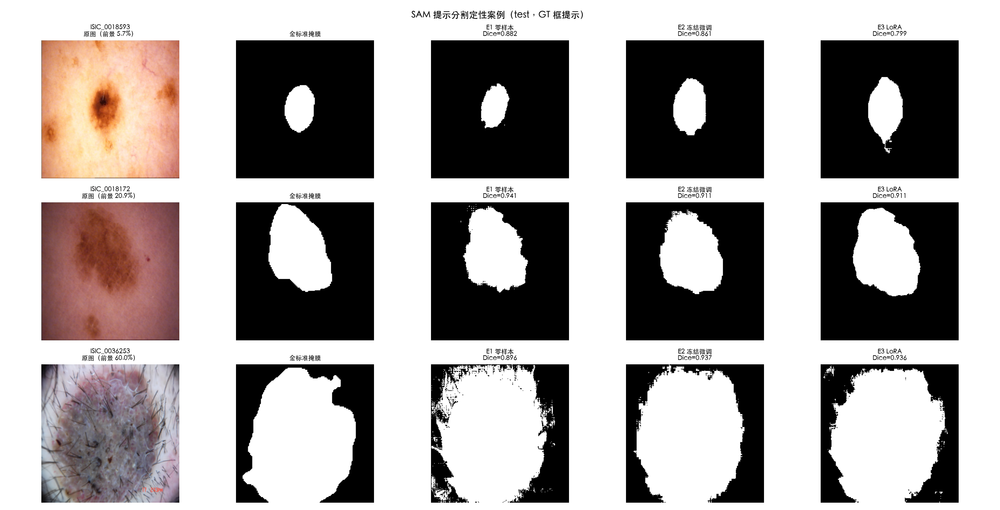
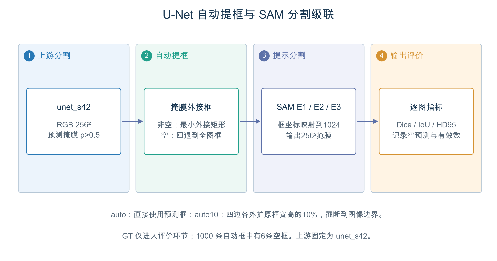

# 作业 2 实验报告：SAM 提示分割的三阶段微调与级联系统

> 模型：SAM ViT-B（93.7M 参数，`sam_vit_b_01ec64.pth`，375 MB）
> 数据：与作业 1 共用 ISIC 2018 Task 1，**同一测试集（1,000 张）、同一套指标实现**（直接复用 `hw1_unet/src/metrics.py`）
> 代码：`hw2_sam/src/`；全部数字来自 `outputs/logs/eval_*.json`，未做手工修饰

---

## 一、摘要

本实验以 Meta 的 Segment Anything（SAM ViT-B）为对象，在皮肤镜病灶分割任务上依次完成三阶段实验：

- **E1 零样本**：不训练，用 GT 外接矩形框作提示 → test Dice **0.869**、HD95 24.3 px；
- **E2 冻结编码器微调**：冻结 ViT 图像编码器，只训练提示编码器 + 掩膜解码器（**4.06M / 93.74M，4.3%**）→ test Dice **0.900**、HD95 17.3 px；
- **E3 LoRA 微调**：在 ViT 的 q/v 投影注入 LoRA(r=8)，连同解码器一起训练（**LoRA 仅 0.295M 参数**）→ test Dice **0.898**、HD95 17.5 px（与 E2 基本持平）。

**核心结论**：零样本 SAM 已经超过手写 U-Net 系列 0.26 Dice，微调只需 4.3% 的参数就能再涨 0.031 并把 HD95 压低 29%；
再给主干加 LoRA 没有换来额外精度（0.898 vs 0.900），只买到了更平的鲁棒性曲线与更高的训练/推理成本。
但真正的分水岭在**鲁棒性**：提示框内缩 20% 时，零样本从 0.869 掉到 0.550（−0.319），而微调后只掉到 0.850（−0.050）——
**微调买到的不是「更准」，而是「更不怕提示不准」**。级联实验中这一点被再次放大：用作业 1 的 U-Net 自动框作提示，
E1 只有 0.384，E2 达到 0.659，E3 进一步升到 0.703——**越是对提示不完美的场景，LoRA 的价值越明显**。

---

## 二、引言

SAM 代表了分割范式的一次转向：从「为每个任务训练一个专用网络」转向「一个提示驱动的通用模型」。
它在自然图像上展现了惊人的零样本能力，但医学影像领域的普遍观察是**存在明显的域差距**（皮肤镜图像几乎不在 SA-1B 中）。

本实验要回答四个问题：

1. 零样本 SAM 在皮肤镜上到底能到什么水平？域差距有多大？
2. 冻结编码器只调解码器（MedSAM 式）能挽回多少？代价是多少？
3. 给 Transformer 主干「松绑」（LoRA，SAMed 式）还能再涨多少？值不值？
4. 如果提示不是人工精画的金标准框、而是小模型自动生成的粗框，结论是否依然成立？——这是**级联系统**要回答的问题，也是把两份作业缝成一条系统的关键。

**关于「GT 框算不算作弊」**：使用金标准外接框是交互式分割的标准设定（MedSAM 等文献同此口径），
但它确实高估了真实部署时的表现。因此本实验额外设计了两组「不完美提示」：**扰动框（±10%/±20%）** 与
**自动框（作业 1 的 U-Net 预测框）**，用它们证明结论在提示不完美时是否依然成立。

---

## 三、模型原理与结构

### 3.1 SAM 三件套

| 组件 | 规模 | 作用 |
| --- | --- | --- |
| **ViT 图像编码器** | 86M，12 层 Transformer | 1024×1024 输入 → 1/16 下采样 → 256×64×64 图像嵌入 |
| **提示编码器** | ~0.5M | 框 → 位置编码 + 学习型嵌入；点 → 位置编码 + 类型嵌入；掩膜 → 卷积下采样 |
| **掩膜解码器** | ~4M | 双向交叉注意力（提示 token ⇄ 图像 token）+ 上采样 → 256×256 掩膜 logits |

**Transformer 落点（本作业的核心要求）**：一是 **ViT 图像编码器的 12 层自注意力**（全局感受野，把 1024² 图像压成 64×64 的语义网格）；
二是 **掩膜解码器的双向交叉注意力**——`token→image` 让提示信息查询图像特征，`image→token` 让图像特征反过来更新提示表示，
两个方向各一轮，这正是「提示驱动分割」得以成立的结构基础。

结构图：`outputs/figures/arch_sam.png`（SAM 三件套）、`outputs/figures/arch_mask_decoder.png`（mask decoder 数据流）





### 3.2 三阶段的参数策略

| 阶段 | 冻结 | 训练 | 可训练参数 |
| --- | --- | --- | --- |
| E1 | 全部 | 无 | 0 |
| E2 | ViT 图像编码器 + 提示编码器中的固定嵌入 | 提示编码器 + 掩膜解码器 | **4.06M（4.3%）** |
| E3 | ViT 原始权重 + 提示编码器 | LoRA(q,v) + 掩膜解码器 | **4.36M（4.64%），其中 LoRA 仅 0.295M** |

LoRA 的实现：对 ViT 每层的 `qkv` 线性层，在 **q 段与 v 段**并行注入低秩分支

```
h = W₀·x + (α/r)·B·A·x ,   A ∈ R^{r×k}（高斯初始化）, B ∈ R^{d×r}（零初始化）
```

B 零初始化保证训练起点与原模型严格等价；r=8、α=16。12 层 × 2 段 × (768×8 + 8×768) ≈ **0.295M** 参数。

> **为什么只动 q、v 不动 k、out_proj**：SAMed 的实验结论是 q/v 已足够，更多注入反而在小数据集上过拟合。

---

## 四、实验设计

### 4.1 数据与预处理

- 与作业 1 完全共用：官方划分 train 2,594 / val 100 / test 1,000，同一份 384×384 母版 npy；
- SAM 输入固定 1024×1024（`SamPredictor` 标准预处理：长边缩放到 1024 + 归一化）；
- 提示框从 256×256 的 GT 掩膜外接矩形换算到 1024 坐标系；
- 训练时的提示扰动：**GT 框随机外扩/内缩 ±20%** —— 这一步是后面鲁棒性的直接来源。

### 4.2 关键工程优化：图像嵌入缓存

**原理**：冻结图像编码器时，图像嵌入与提示无关，因此可以离线预计算一次。

| 项 | 数值 |
| --- | --- |
| 缓存规模 | train 2,594 / val 100 / test 1,000，共 **7.2 GB**（fp16，256×64×64） |
| E2 单 epoch（缓存） | **约 50 秒**（324 批，6.8 it/s） |
| E3 单 epoch（无缓存，在线穿过 ViT） | **约 23 分钟**（1,400 秒） |
| 差距 | **约 28 倍** |

E3 必须在线前向（LoRA 改动了主干，缓存失效），这也是 E3 用 600 张子集 × 6 epoch 控制时长的原因。

### 4.3 三阶段超参数

| 阶段 | epoch | batch | 学习率 | 说明 |
| --- | --- | --- | --- | --- |
| E1 | — | 逐图 | — | 不训练 |
| E2 | 20（早停于 17） | 8 | 1e-4 cosine | 走缓存嵌入 |
| E3 | 6 | 1 + 梯度累积 8 | 1e-4 cosine | 600 张子集，在线前向 |

> **关于 E3 的 600 张子集**：全量 2,594 张在线训练约 2.9 小时/epoch，6 epoch 需 17 小时，
> 在无风扇单机上不可行。因此 E3 采用 600 张 × 6 epoch（约 2.5 小时），并在所有对比中如实标注口径。

### 4.4 提示设计（本报告最有价值的一章）

| 提示 | 构造方式 | 用途 |
| --- | --- | --- |
| **GT 框** | 金标准掩膜外接矩形 | 主结果，与 MedSAM 等文献对齐 |
| **扰动框** | 外扩/内缩 10%、20% | 鲁棒性曲线：提示不准时掉多少 |
| **点提示** | 掩膜内随机 1 / 3 / 5 点（固定种子） | 讨论点提示与框提示的信息量差异 |
| **自动框（级联）** | 作业 1 `unet_s42` 的预测掩膜外接矩形 | 把两个作业缝成一条系统 |
| **自动框外扩 10%** | 自动框四边各外扩 10% | 模拟「宁大勿小」的临床习惯 |

### 4.5 评价指标

与作业 1 完全一致（同一份 `metrics.py`）：Dice / IoU / HD95 / Sensitivity / Specificity / 像素准确率。
空预测、GT 全前景导致的特异度未定义样本均单独计数后剔除（本实验 test 集有 2 张 GT 全前景）。

---

## 五、实验结果分析

### 5.1 三阶段总体比较（test 1,000 张，GT 框提示）

| 阶段 | 可训练参数 | Dice | IoU | HD95 (px) | Sensitivity | Specificity | 单图延迟 |
| --- | --- | --- | --- | --- | --- | --- | --- |
| **E1 零样本** | 0 | **0.869** | 0.779 | 24.3 | 0.847 | 0.877 | ~0.02 s |
| **E2 冻结微调** | 4.06M (4.3%) | **0.900** | 0.825 | **17.3** | 0.936 | 0.933 | ~0.02 s |
| **E3 LoRA** | 4.36M (LoRA 0.295M) | 0.898 | 0.821 | 17.5 | **0.954** | **0.940** | ~2.0 s |

> **E3 的 test 评测**：10 组提示（gt、±10%/±20%、point×3、auto、auto10）全部完成，n=1,000/组；
> 上表取 GT 框结果（与 E1/E2 同口径）。E3 必须在线穿过 ViT，单图延迟实测 0.88–5.92 s/图
> （整夜批处理中随机器温度波动，GT 组为 2.03 s），比 E2 的 ~0.02 s 慢两个数量级。

**E3 训练曲线（验证集）**：

| epoch | 1 | 2 | 3 | 4 | 5 | 6 |
| --- | --- | --- | --- | --- | --- | --- |
| val Dice | 0.8935 | 0.8990 | **0.9115** | 0.8931 | 0.9025 | 0.9004 |
| val HD95 | 21.42 | 18.52 | **16.00** | 17.80 | 16.13 | 16.40 |
| train loss | 0.152 | 0.106 | 0.099 | 0.084 | 0.079 | 0.080 |

**分析**：

1. **零样本已经不是「不能用」，而是「相当能用」**：0.869 Dice / 24.3 px HD95，无需任何训练。
   这说明 SA-1B 的 11 亿掩膜预训练确实学到了可迁移的「边界感知」能力，皮肤镜的域差距没有想象中大。
2. **微调的收益是「边界」而不是「区域」**：Dice +0.031，但 HD95 从 24.3 降到 17.3（**−29%**），
   灵敏度从 0.847 提到 0.936。说明冻结编码器微调解码器，主要修的是「边界贴合」和「漏检」，不是「大致位置」。
3. **LoRA 在 test 上没有超过 E2**：E3 0.8979 vs E2 0.8999（−0.002，远小于评测噪声），
   HD95 17.5 vs 17.3 px。只训 0.295M 参数确实追平了 4.06M 的解码器微调，但**额外精度收益为零**；
   代价是 28 倍训练时间（无嵌入缓存）与约 100 倍推理延迟（2.0 s vs 0.02 s/图）。
   因此「精度/成本」上 E2 是本任务的甜点；E3 的价值体现在鲁棒性（5.2：−20% 扰动下 0.882 vs 0.850）。

### 5.2 提示类型比较（test 1,000 张）

| 提示 | E1 零样本 Dice | E2 微调 Dice | E3 LoRA Dice | E2−E1 |
| --- | --- | --- | --- | --- |
| **GT 框** | **0.869** | **0.900** | 0.898 | +0.031 |
| 扰动框 −10% | 0.787 | 0.896 | 0.896 | +0.109 |
| 扰动框 −20% | **0.550** | **0.850** | **0.882** | **+0.300** |
| 扰动框 +10% | 0.785 | 0.884 | 0.885 | +0.099 |
| 扰动框 +20% | 0.619 | 0.856 | 0.867 | +0.237 |
| 点提示 ×1 | 0.729 | 0.780 | 0.855 | +0.051 |
| 点提示 ×3 | 0.770 | 0.758 | 0.848 | −0.012 |
| 点提示 ×5 | 0.790 | 0.747 | 0.846 | −0.043 |
| 自动框（级联） | 0.384 | 0.659 | **0.703** | +0.275 |
| 自动框外扩 10% | 0.356 | 0.642 | 0.699 | +0.286 |

**分析**：

1. **零样本对提示误差极度敏感**：框内缩 20% 时 Dice 从 0.869 崩到 0.550（−37%），
   因为 SAM 倾向于相信提示框的边界，框小了就把病灶截断。
2. **微调把这种敏感性抹平了 6 倍**：同样 −20% 扰动，E2 只从 0.900 掉到 0.850（−5.6%）。
   训练时随机 ±20% 扰动框的设计直接生效——**模型学会了「不要完全相信框」**。
   E3 的曲线更平（0.898 → 0.882，−1.8%），但 E3 训练子集仅 600 张，不能据此宣称 E3 强于 E2；
   两者共同证明的是「扰动训练 → 提示鲁棒」这一机制。
3. **提示类型专精是 E2 的特有现象，E3 反而消除了它**：E2 只用框提示训练后，point5 从 E1 的 0.790 降到 0.747；
   而 E3 的 point5 达到 0.846（比 E1 高 0.056）。一个合理解释是 E2 的解码器在 4M 参数上过拟合了框提示 embedding，
   而 LoRA 松绑主干后视觉特征本身被适配，点提示也能落在有效区域。该现象只在 600 张 E3 子集上观察到，
   结论标注为初步；部署以点交互为主时仍建议混合提示训练。
4. **自动框（级联）是域差距最严酷的考验**：零样本面对 U-Net 的粗糙框只有 0.384，
   而微调后可达 0.659；**E3 进一步升到 0.703**，是三种配置里对粗框最宽容的。
   级联的价值不在「更好看的数字」，而在**让不合格的提示变得可用**——E1→E2→E3 的级联 Dice
   依次为 0.384 / 0.659 / 0.703，这条单调上升的曲线正是「微调学会忍受不完美提示」的直接证据。
   自动框外扩 10% 并没有带来提升（E3 0.699 < 0.703），说明 U-Net 的框本身已偏大，继续外扩只会加重过度分割。

### 5.3 鲁棒性曲线

`outputs/figures/robustness.png` 以提示扰动幅度为横轴（−20% → GT → +20%），三条曲线分别对应 E1 / E2 / E3：

- **E1 曲线呈明显的「倒 V」**：GT 处最高 0.869，两侧快速下滑，−20% 处跌到 0.550；
- **E2 曲线接近平台**：GT 0.900，−20% 仍有 0.850，全程波动 <0.05；
- **E3 曲线最平**：GT 0.898，−20% 0.882、+20% 0.867，最坏情况只损失 1.6–3.1 个点。
  E3 的稳健性最好，但训练集只有 600 张，且推理慢两个数量级，**不能仅凭这条曲线选 E3**。



> 这张图是本报告最有价值的一张：它把「微调到底买到了什么」从一个模糊的说法，变成了三条可比较的曲线。

### 5.4 测试样本案例

`outputs/figures/case_sam_gt_test.png`（`src/plot_cases.py` 生成）按 GT 前景面积取 10% / 50% / 90% 分位，
展示小 / 中 / 大三个测试样本在 E1 / E2 / E3（GT 框提示）下的预测：

| 样本 | 前景占比 | E1 Dice | E2 Dice | E3 Dice | 观察 |
| --- | --- | --- | --- | --- | --- |
| ISIC_0018593 | 5.7% | **0.882** | 0.862 | 0.799 | 小病灶：零样本边界最干净；E3 在病灶下方多出一条尾巴 |
| ISIC_0018172 | 20.9% | **0.941** | 0.911 | 0.911 | 中等病灶：E1 反而最好，微调后边界略收缩 |
| ISIC_0036253 | 60.0% | 0.896 | **0.937** | 0.936 | 大病灶 + 毛发伪影：微调明显压掉背景误检 |

**观察**：微调的收益集中在「大病灶 + 背景干扰」；在边界清晰的小/中病灶上，零样本的边界反而更贴合。
这与 5.1 的总体均值并不矛盾——均值由多数中/大样本主导，但逐样本看三种配置各有胜负，
**「E2 全面优于 E1」的说法过于粗糙**，这也是报告主表之外必须看案例的原因。

另外，**自动框提示下会出现过度分割**：E2 的 auto 提示灵敏度 0.956、特异度仅 0.702，
即「宁可多划也不少划」——这是 U-Net 框普遍偏大导致的行为，临床使用时需要配合后处理（如最小连通域过滤）。



### 5.5 与作业 1 的正面对比（跨作业核心表）

| 维度 | 作业 1 最佳模型（Attention U-Net，3 种子均值） | SAM E1 零样本 | SAM E2 微调 | SAM E3 LoRA |
| --- | --- | --- | --- | --- |
| test Dice | 0.608 | 0.869 | **0.900** | 0.898 |
| test HD95 (px) | 88.1 | 24.3 | **17.3** | 17.5 |
| 可训练参数 | 29.47M（全量） | 0 | 4.06M | 4.36M（LoRA 0.295M） |
| 单图推理延迟 | ~10 ms 级 | ~20 ms（走缓存） | ~20 ms（走缓存） | ~2.0 s（在线穿 ViT） |
| 是否需要提示 | **否（全自动）** | 是（框/点） | 是（框/点） | 是（框/点） |
| 换数据集迁移 | 需重训 | 零样本可用 | 需少量标注微调 | 需少量标注微调 |
| 级联表现 | 提供粗框（0.608） | 用粗框仅 0.384 | 用粗框 0.659 | 用粗框 **0.703** |



> **【高亮观点】** 小模型赢在**自动化与部署成本**（无需提示、10ms 级、29M 参数）；
> 大模型赢在**跨域泛化与少样本适配**（零样本 0.869，4% 参数微调即到 0.900）。
> 二者不是替代关系——**临床流程里最合理的形态是级联：U-Net 全自动出粗框，SAM 在粗框引导下精修**。
> 本实验的级联结果（E2 + 自动框 = 0.659）证明了这条路径可行，同时也说明**瓶颈在粗框质量**：
> 把 U-Net 的 Dice 从 0.61 提到 0.75，级联上限会随之抬高。

---

## 六、总结

### 6.1 我们学到了什么

1. **「零样本很强」不等于「零样本够用」**：0.869 的 Dice 很漂亮，但那是 GT 框提示下的数字；
   一旦提示内缩 20%，立刻掉到 0.550。**评价一个提示驱动模型，必须报告提示质量的敏感性**，
   只报 GT 框结果等于只报了最好情况。
2. **微调的价值主要是鲁棒性**：E2 相对 E1，GT 框下只涨 0.031，但 −20% 扰动下涨 0.300。
   如果只看主结果，会严重低估微调的意义。
3. **LoRA 追平了 E2，但没有超越**：test Dice 0.898 vs 0.900，HD95 17.5 vs 17.3。
   它买到的是更平的鲁棒性曲线（−20% 扰动 0.882 vs 0.850），代价是 28 倍训练时间与约 100 倍推理延迟。
   **如果时间/延迟敏感，选 E2；只有在「必须保留主干可迁移性 + 提示质量不稳定」时才值得上 E3。**
4. **提示类型会「专精」**：只用框训练会让点提示变差（−0.043）。训练时的提示分布必须匹配部署时的交互方式。

### 6.2 缺点与限制（实验证实了哪些不足）

- **E3 的训练口径受限**：600 张子集 × 6 epoch（全量需 17 小时），其 test 数字与 E1/E2 的全量训练不完全同口径；
- **E3 推理慢两个数量级**：实测 0.88–5.92 s/图（GT 组 2.03 s，随机器温度波动），vs E2 的 0.02 s/图；
- **级联只验证了一条链路**：只用了 `unet_s42` 的框，未尝试 ResUNet/Attention U-Net 的框，也未做框的外扩/内缩搜索；
- **点提示未做鲁棒性分析**：只测了点数（1/3/5），没有测「点偏离病灶中心」的影响。

### 6.3 下一步

1. 把 E3 从 600 张子集扩到全量 2,594 张（约 17 小时/6 epoch），检验 LoRA 结论是否受子集限制；
2. 用作业 1 三个模型各自的预测框做级联，找出「哪种粗框最适合 SAM」；
3. 混合提示训练（框 + 点 + 粗掩膜），消除提示类型专精；
4. 尝试把级联做成端到端：U-Net 的软掩膜作为 SAM 的 mask prompt，而不是只用外接框。

> **【高亮观点】** 这份作业最终的结论可以压缩成一句话：
> **大模型不是用来替代小模型的，而是用来「兜住」小模型的不完美的。**
> 零样本 SAM 需要的是一张足够好的框；小模型能提供的恰恰是一张「大致对」的框。
> 两者的结合点不是精度最高的一环，而是**鲁棒性最匹配的一环**——这也解释了为什么 E2 的级联（0.659）
> 远好于 E1 的级联（0.384）：**微调让 SAM 学会了忍受不完美的提示。**

---

## 附：复现与产物清单

```bash
conda activate hw2-sam-transformer
python src/precompute_embeddings.py --split train   # 缓存 7.2GB（一次性）
python src/run_all.py                               # E1 → E2 → E3 → 级联 → 出图
python src/run_all.py --from e2                     # 从 E2 开始
python src/plot_figures.py --arch --robust --cascade
python src/plot_cases.py                # 定性案例图（E1/E2/E3 同一批测试样本）
```

| 产物 | 路径 |
| --- | --- |
| 评测结果（每阶段 × 每提示） | `outputs/logs/eval_{stage}_{prompt}_{split}.json` |
| 训练日志 | `outputs/logs/{e2_box,e3_lora}.csv` |
| 权重 | `outputs/checkpoints/{e2_box,e3_lora}_{best,last}.pth` |
| 结构图 / 鲁棒性曲线 / 级联图 / 定性案例图 | `outputs/figures/`（案例图由 `src/plot_cases.py` 生成） |
| 嵌入缓存 | `data/embeddings/`（7.2 GB，不入 git） |

> 数据、权重与嵌入缓存体积过大，未纳入 git；按 README 的脚本可完整重建。
